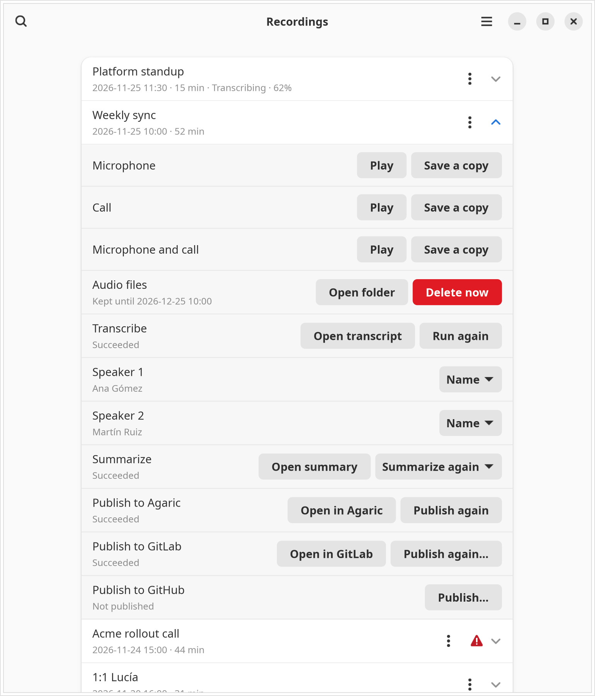
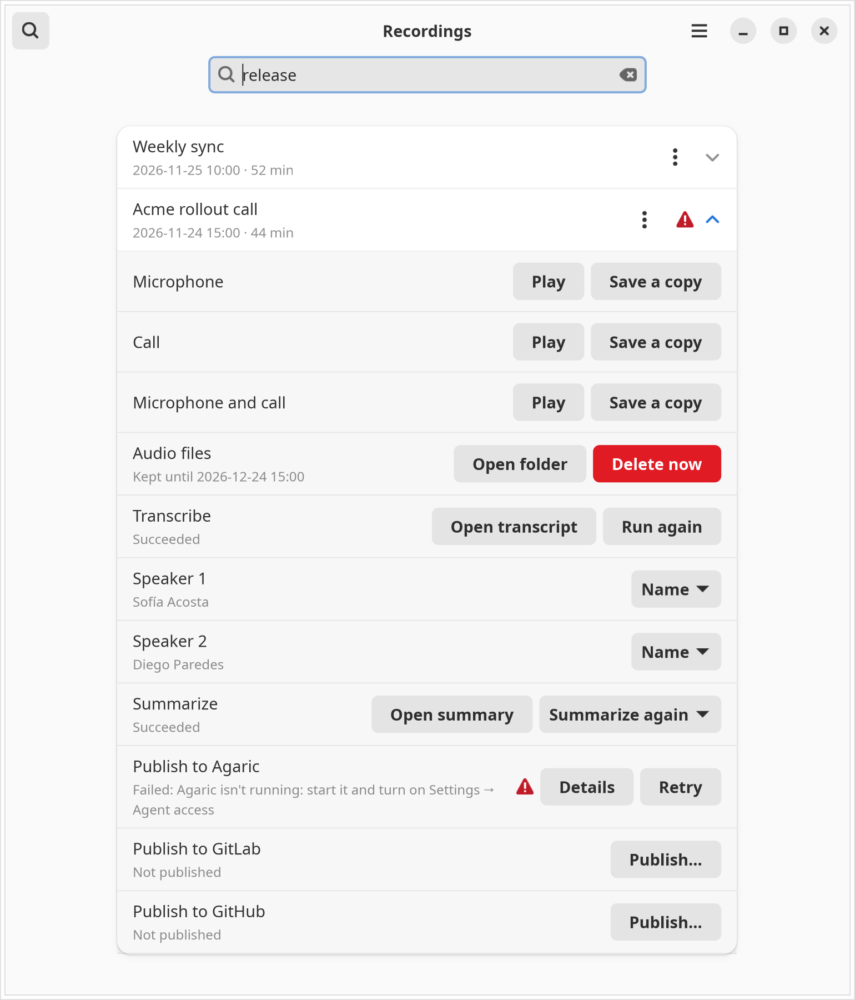
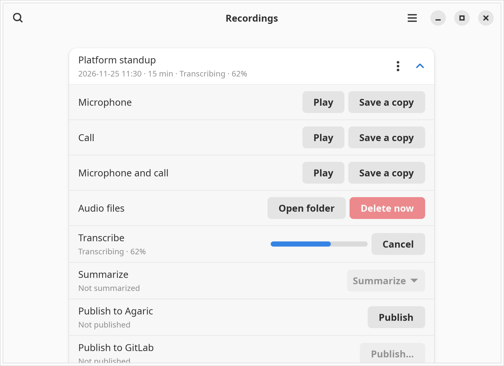
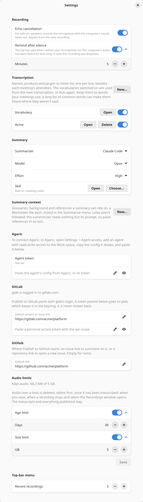

# Minutas

[](https://www.bestpractices.dev/projects/17100)

Minutas records your work meetings on GNOME, transcribes them with who said what, and publishes them where your team keeps its notes: an [Agaric](https://github.com/jfolcini/agaric) meeting page, a GitLab or GitHub issue or comment. It is for someone who spends the day in calls on an Ubuntu laptop and would rather not take notes during them. The recording and the transcription stay on your computer; nothing leaves it until you press a button.

**Status:** young. Minutas works end to end, from Record in the top bar to a published summary, but expect rough edges, and please [report what you hit](https://github.com/jfolcini/minutas/issues).

<p>
  
  
</p>

## What it does

- **Records from the top bar.** Record, Pause, Finish and Discard in a GNOME top-bar menu, with a timer while it records, a reminder to tell the others you are recording, and another, with Finish, when nothing has been heard for a while. Stopped by mistake? Continue recording, under the recording in the menu, records into it again, and it stays one recording. Your microphone and the computer's audio are kept as two tracks, so "me" versus "them" needs no guessing. Recording carries on through the lock screen, and if anything stops it early, what was captured is kept.
- **Transcribes on its own, on your computer.** When you press Finish, [Parakeet](https://huggingface.co/nvidia/parakeet-tdt-0.6b-v3) writes the transcript and [pyannote](https://huggingface.co/pyannote/speaker-diarization-community-1) tells the people on the call apart, while the window shows how far it has got. It is built for Spanish and English, often in the same meeting, and runs on the CPU at idle priority, so a call you record meanwhile keeps the machine.
- **Knows the meeting.** The event in your GNOME calendar names the recording and offers its attendees as names for the speakers; a vocabulary of your own names, products and jargon helps the transcriber spell them.
- **Summarizes on demand.** Summarize asks the [Devin CLI](https://docs.devin.ai/cli/reference/commands) or [Claude Code](https://code.claude.com/docs/en/cli-reference), whichever you choose, for a summary in English: General, Standup, 1:1, Stakeholder call, or a prompt you type and can save.
- **Publishes with one button each.** Publish to Agaric files a meeting page with the audio, transcript and summary. Publish to GitLab and Publish to GitHub comment on an issue, or open one, with the summary and a link to the transcript. Every run is kept with its result and a button that opens what it made.
- **Says what went wrong and how to fix it.** A failed run shows the reason and the fix, with Retry and Details; a warning mark in the top-bar menu and a notification point you to it. Nothing retries on its own.
- **Keeps the disk in check.** By default audio is kept for 30 days, and the oldest goes sooner if all of it passes 5 GB. It is only ever deleted once it has been transcribed, and both limits can be changed or turned off. Transcripts, summaries and what you published stay.

## Requirements

- Ubuntu 24.04 or later, with GNOME on Wayland, the default session. Other distributions, macOS and Windows are not supported yet.
- An x86_64 or ARM64 computer. No graphics card is needed: everything runs on the CPU.
- A free [Hugging Face](https://huggingface.co/join) account, for the speaker model (see [Before you start](#before-you-start)).
- For each optional part, its own tool: Agaric, `glab`, `gh`, and the Devin CLI or Claude Code. [What install.sh does](#what-installsh-does) lists them, with the versions; install.sh tells you which are missing and how to get them.

## Install

On Ubuntu 24.04 or later, in a terminal:

```bash
git clone https://github.com/jfolcini/minutas && cd minutas && ./install.sh
```

It asks for your password, through `sudo`, only if Ubuntu packages are missing, and for a Hugging Face token once ([Before you start](#before-you-start)). The first run downloads the speech models and their libraries, which takes a while; later runs only fix or update what changed. When it ends, it lists what is left to do, if anything.

> [!IMPORTANT]
> **Log out and back in once** when install.sh is done. GNOME on Wayland loads a new top-bar extension only at login, so the Minutas microphone appears in the top bar once you log back in. install.sh says so whenever it is needed: after the first install, and after an update that changed the extension.

Keep the clone: `minutas update` updates from it. You can run `./install.sh` again at any time; each step prints `ok` when there is nothing to do, and a run that stopped on a failure carries on from there.

### Before you start

The speaker model, pyannote's [speaker-diarization-community-1](https://huggingface.co/pyannote/speaker-diarization-community-1), is free but gated: Hugging Face hands it only to an account that accepted its conditions. So, once:

1. Sign in to Hugging Face and accept the conditions on [the model's page](https://huggingface.co/pyannote/speaker-diarization-community-1).
2. Create a token with read access at [Settings → Access Tokens](https://huggingface.co/settings/tokens).
3. Paste it when install.sh asks. It goes into the GNOME keyring, and install.sh uses it only to download the model.

### What install.sh does

Everything but the Ubuntu packages goes into your home folder, and everything it downloads besides Ubuntu's own packages is pinned to an exact version in the repository.

| Step | What it puts in place | Why |
| --- | --- | --- |
| System packages | GTK 4, libadwaita and Ubuntu's PyGObject; GStreamer with its Opus, Ogg and PipeWire capture plugins; the GNOME calendar libraries; `gio`, `secret-tool` and `curl`; installed with `apt` | The window, the recorder, the calendar lookup and the keyring need them. `apt` installs for the whole system, the one thing that needs `sudo`; it runs only when a package is missing, and says which |
| uv | [uv](https://docs.astral.sh/uv/) in `~/.local/bin`, unpacked only once it matches the checksum pinned beside its version | It builds both Python environments below with exactly the versions `uv.lock` pins |
| Speech environment | Parakeet through NeMo, pyannote, Silero VAD and a CPU-only PyTorch, with a Python of their own, in `~/.local/share/minutas/speech` | The speech stack needs its own Python, whatever Python your Ubuntu release ships. Rebuilt only when `uv.lock` changes |
| App | The program in `~/.local/share/minutas/app`, on Ubuntu's own Python; the `minutas` command in `~/.local/bin`; a Minutas launcher among your apps, which opens the Recordings window | The window draws with Ubuntu's GTK, which only Ubuntu's Python can load |
| GNOME extension | The top-bar menu in `~/.local/share/gnome-shell/extensions/minutas@jfolcini.github.io`, turned on in GNOME's settings | GNOME Shell reads extensions only at login: hence the log out |
| Hugging Face token | Asked once, kept in the GNOME keyring | The speaker model downloads only with it ([Before you start](#before-you-start)) |
| Models | Parakeet v3 and pyannote community-1, at the revisions the repository pins, in `~/.cache/minutas/models` | Transcription then runs from the disk, offline |

Then it checks for the optional tools, installs none of them, and says what each one is for and how to get it:

| Tool | Needed for | Found when |
| --- | --- | --- |
| Agaric's `agaric-mcp` bridge | Publish to Agaric | Agaric 0.26 or newer has been started once |
| `glab` | Publish to GitLab | 1.91 or newer is on the PATH. Use GitLab's own `.deb` from [its releases](https://gitlab.com/gitlab-org/cli/-/releases): the snap can't read the recordings, which live in a hidden folder |
| `gh` | Publish to GitHub | 2.45 or newer is on the PATH: `sudo apt install gh` |
| The Devin CLI or Claude Code | Summarize | Either is on the PATH, Claude Code at 2.1.166 or newer (`claude update` updates an older one); install.sh prints the install and login commands for both |

## First steps

<p>
  
</p>

1. **Record.** Open the microphone menu in the top bar and choose Record. A notification reminds you to tell the participants. Choose Finish when the meeting ends.
2. **Wait for the transcript.** Transcription starts on its own. The top-bar menu and the Recordings window show how far it has got, and a notification says when the transcript is ready: click it, or the recording in the menu, to open it in the Recordings window.
3. **Name the speakers.** Expand the recording: the call's speakers are listed as Speaker 1, Speaker 2… in the order they first speak. Name each one with its Name menu, from the meeting's attendees or a name you type, and the transcript is written again with the names. "Me" is always the microphone track.
4. **Summarize.** Pick a preset from the Summarize menu, or Custom… to type what the summary should cover.
5. **Publish.** Publish to Agaric, Publish to GitLab or Publish to GitHub. GitLab and GitHub ask for a link: an issue link gets a comment, a project or repository link a new issue. Each run keeps its result and a button that opens it.

A recording's ⋮ menu renames it or moves it to the Trash; its tracks can be played, alone or mixed and at up to twice the speed without the voices going up in pitch, saved elsewhere or deleted now. The search button, or Ctrl+F, finds the recordings that hold every word you type in their name, date or transcript, speakers' names included.

### Settings

Open them from the window's main menu or the top-bar menu. Every change is saved as you make it, except the audio limits, which wait for Save because they delete audio.

<p>
  
</p>

- **Recording:** Echo cancellation, on unless you turn it off: the microphone is recorded with the computer's sound taken out, so the people on a call on speakers aren't transcribed twice. It applies from the next recording. Remind after silence: how many minutes of silence, five unless changed, before the top bar reminds you that it is still recording, or never.
- **Transcription:** the vocabulary, one word or phrase a line, opened in your text editor. Most people need only this one; New… makes another, say for one client, and each one switched on is used from the next transcription.
- **Summary:** the summarizer, the Devin CLI or Claude Code, with its model and effort, and the skill file the summary follows, a built-in meeting-notes one unless you choose another. Log in to the summarizer once in a terminal: `devin auth login` or `claude auth login`.
- **Agaric:** paste the config Agaric shows when you add an agent in its Settings → Agent access, with read-write access to the Work space. The token goes to the GNOME keyring and is never shown back.
- **GitLab:** the default link Publish to GitLab starts from, and whether `glab` is logged in to its server. Log in with `glab auth login`, or paste a personal access token with the api scope here; it is handed to `glab`, which keeps it in the keyring.
- **GitHub:** the default link Publish to GitHub starts from. Log in once with `gh auth login`.
- **Audio limits:** the age and size limits, with how much audio is kept now.
- **Top-bar menu:** how many recent recordings the menu lists.

If your calendar is in GNOME Online Accounts (Settings → Online Accounts), Minutas finds the event a recording overlaps and takes its name and attendees from it.

## Updating

Choose **Update Minutas** in the Recordings window's main menu, or run:

```bash
minutas update
```

Either one moves your clone to the latest release and runs its `install.sh`, which only acts on what changed. When it is done, close the Recordings window and open it again to run the new version; if the update changed the top-bar extension, it also says to log out and back in.

## Privacy

Recording, transcription and speaker detection run on your computer. Content leaves it only when you press a button for it:

| You press | What leaves, and where to |
| --- | --- |
| Summarize | The transcript, inside the prompt, to the summarizer you chose, which sends it to its own service under your account. It runs isolated: it can't read your files, run commands or browse |
| Publish to Agaric | The page, audio, transcript and summary, to Agaric on the same computer |
| Publish to GitLab | The summary, transcript and audio, to the GitLab server of the link you give |
| Publish to GitHub | The summary, and the transcript in a secret gist, which anyone with its link can read; no audio |

The Agaric agent token and the Hugging Face token are kept in the GNOME keyring; GitLab's and GitHub's logins stay with `glab` and `gh`. Recordings live in `~/.local/share/minutas/recordings`, one folder each, and your settings in `~/.config/minutas`. See [SECURITY.md](SECURITY.md) for the threat model and how to report a vulnerability.

## Troubleshooting

Most problems explain themselves: a failed run says what went wrong and how to fix it, and its Details show the whole output. A few you may meet first:

- **No microphone in the top bar.** Log out and back in once after installing.
- **The top-bar menu holds only "Install Minutas…".** It finds no `minutas` command on the PATH or in `~/.local/bin`. Run `./install.sh` from your clone.
- **install.sh: "Hugging Face refused pyannote/speaker-diarization-community-1".** Accept the model's conditions on Hugging Face with the account the token belongs to, then run install.sh again. To replace the token: `secret-tool clear service minutas username huggingface`, then run install.sh again.
- **Update Minutas fails at "System packages".** The new release needs an Ubuntu package, and `sudo` can ask for your password only in a terminal: run the `sudo apt install …` it names, then Update Minutas again.
- **Summarize, Publish to GitLab or Publish to GitHub is greyed out.** Its tool is missing or too old, or for the publishers there is no summary yet; the row, or the button's tooltip, says which, and how to install the tool.
- **"Agaric isn't running".** Start Agaric and turn on its Settings → Agent access, then Retry.
- **"glab isn't logged in to …" or "gh isn't logged in to …".** Log in to that server with the command the message names, or for GitLab paste a token in the Settings, then Retry.

## Documentation

| Document | Purpose |
| --- | --- |
| [docs/design.md](docs/design.md) | The design: decisions, pipeline, components, milestones |
| [CONTRIBUTING.md](CONTRIBUTING.md) | Setting up, the checks, sending a patch |
| [AGENTS.md](AGENTS.md) | Principles and conventions for anyone, human or agent, changing the code |
| [SECURITY.md](SECURITY.md) | The threat model, and reporting a vulnerability |

## License

[GPL-3.0-or-later](LICENSE).
