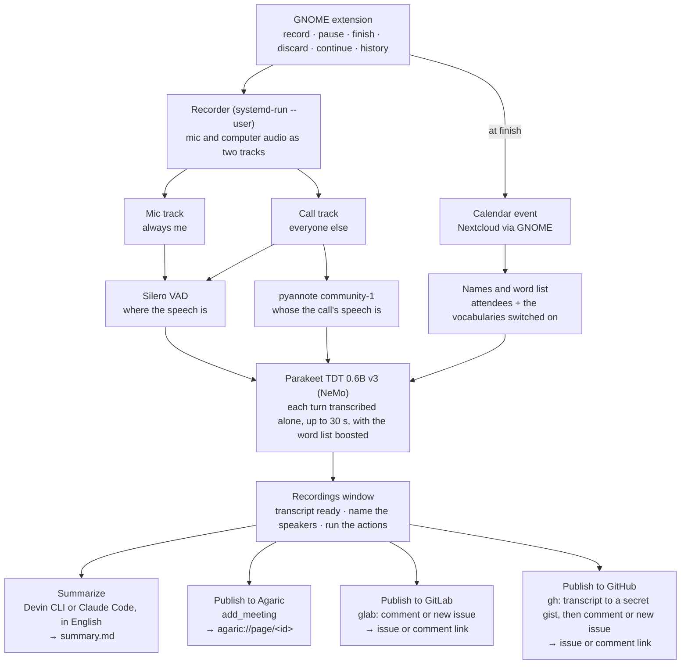
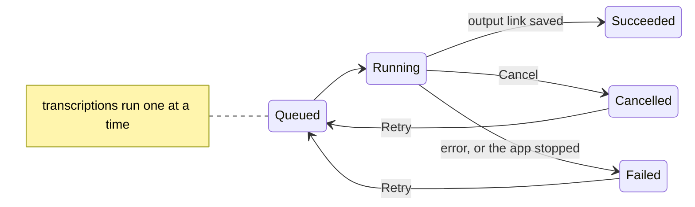

# Minutas: meeting capture for Agaric

## Goal and scope

Minutas, a local tool for GNOME on Wayland (Ubuntu 24.04's GNOME 46 and newer), records a work meeting, transcribes it with who said what, and files it in Agaric as a meeting page. Agaric already stores and shows meetings ([#5364](https://github.com/jfolcini/agaric/issues/5364)); this tool does everything before that.

- **Languages:** Spanish, Argentine accents above all, and English from non-native speakers, often in the same meeting.
- **Outputs:** a transcript on stop, then on demand a summary, an Agaric meeting page and a GitLab or GitHub comment or issue, each listed with its link in the recording's history.
- **When it runs:** on the desktop, after the call; nothing heavy runs during it. Phone voice notes reach the desktop through Agaric's sync.
- **Out of scope:** live transcription, phone-call audio (Android doesn't allow capturing it), any change to Agaric, and forking an existing tool.

## Decisions

The stack is settled: Python, Parakeet v3, pyannote community-1, two recorded tracks, the calendar through GNOME, Devin or Claude Code for the summary, `glab` for GitLab and `gh` for GitHub. Only transcription runs on its own; everything else is a button in the Recordings window.

| Area | Decision | Why |
| --- | --- | --- |
| Where it lives | Outside Agaric; Agaric only stores and shows | Agaric runs no transcriber and calls no LLM ([#5364](https://github.com/jfolcini/agaric/issues/5364)) |
| Platform | GNOME 46+ on Wayland only for now; macOS and Windows later (see Later) | Ubuntu 24.04 ships GNOME 46; Ubuntu 26.04 has no Xorg session |
| Hardware | A laptop without an NVIDIA GPU | Parakeet on the CPU; Qwen3-ASR is only worth testing with a GPU |
| Install | A GitHub repository with an idempotent `install.sh`; `minutas update` moves to the latest release tag and re-runs it | Installs and updates from the repository; details under Installing and updating |
| Language | Python, managed with `uv` | pyannote community-1 is Python-only; new speech models ship in Python first; PyGObject reaches GNOME's calendar and GTK |
| Speech-to-text | Parakeet TDT 0.6B v3 through NeMo, full precision | Most accurate model that runs well on a CPU; covers Spanish and English; NeMo adds phrase boosting |
| Speakers | pyannote community-1 on the call track; the mic track is always me | Best open speaker detector; no four-speaker cap |
| Speaker names | Set per recording in the Recordings window: a calendar attendee or a custom name | A person confirms names before anything is published |
| Recording | Two tracks: mic and computer audio | "Me" versus "them" is exact without AI; speaker detection runs on the call only |
| Echo | PipeWire's echo-cancelled mic by default; a setting records the plain mic | No duplicated call audio in the mic track, whether the call is on headphones or speakers |
| Consent | Pressing Record shows a GNOME notification: "Tell participants you're recording" | A nudge at the moment it matters; the audio may reach GitLab |
| Automation | Only transcription runs on stop; Summarize, Publish to Agaric, Publish to GitLab and Publish to GitHub are buttons per recording | Nothing leaves the machine until I press a button |
| Failures | Every run ends succeeded, failed or cancelled; a failed run shows why and the fix, with a Retry button; nothing retries on its own | A blind retry can post twice or hide a real problem |
| Interface | Top-bar menu (record, pause, finish, discard, continue recording, recent recordings, Recordings, Settings) plus a Recordings window, with the Settings in a dialog over it | The window runs outside GNOME Shell, so a bug can't freeze the desktop |
| Calendar | Nextcloud through GNOME Online Accounts and Evolution Data Server | GNOME holds the login and expands repeating meetings |
| Summary | The Devin CLI (`devin -p`) or Claude Code (`claude -p`), chosen in Settings, Devin until one is; always written in English, saved as `summary.md`; the model and its effort are Minutas settings, Devin's chosen from what `devin models list` offers and Claude Code's from its model aliases and effort levels, unset meaning the summarizer's own default; so is the skill the summary follows, a Markdown file, unset meaning the built-in meeting-notes one | The account the summarizer uses, Devin's or Claude Code's ([#70](https://github.com/jfolcini/minutas/issues/70)), must be one cleared for meeting content; one language for every summary; the summarizer runs without my own config for it, so the model and the skill are set in Minutas |
| Summary prompts | Built-in presets General, Standup, 1:1 and Stakeholder call, which can't be deleted; Custom is typed at run time and savable as a preset; saved presets can be deleted. Context presets, Markdown files of my own (a glossary, a project's background, references pasted in), made, opened and deleted in the Settings and ticked in the Summarize menu, go with every summary until unticked, as trusted text ahead of the transcript | One click for regular meetings, free text for the rest; what every summary should know is written once, and handed over as text, since the summarizer reads nothing but its prompt |
| Page name | The calendar event's name, else the name the summary proposes, else "Meeting"; Agaric adds the date. A name typed in the Recordings window always wins | A recurring meeting keeps one name; the summary names meetings that had no event |
| Renaming | Publish to Agaric renames the page when its automatic name changed; a typed name is never replaced | Publishing before summarizing still ends with a good name; Agaric links by id, so links survive |
| Taken name | Publish to Agaric stops and asks: Use that page or Rename | Two meetings with one name on one day are rare, and only I know whether they're the same one |
| Agaric | Publish to Agaric runs `agaric-mcp call add_meeting`, with no template; running it again adds the summary and applies a new name | The summary already lists decisions and action items, so a template would repeat them |
| GitLab | Publish to GitLab asks for a link: an issue link gets a comment, a project link a new issue with only a title and body; it posts the summary and links the uploaded transcript and audio, or the transcript alone when the server refuses the audio as too big | The link alone says where and how to post; labels and assignees are set in GitLab |
| GitLab login | [`glab`](https://docs.gitlab.com/cli/api/), logged in once per server, with `glab auth login` or a token pasted in the Settings, which Minutas hands to glab for the GNOME keyring and never keeps; 1.91 or newer, which install.sh only checks for, and the Recordings window keeps Publish to GitLab off until it's there | Already handles gitlab.com and self-hosted servers; glab holds the login, so the tool keeps no GitLab token |
| GitHub | Publish to GitHub asks for a link, starting from the recording's last one, else the default link in the Settings: an issue link gets a comment, a repository link a new issue with only a title and body; it posts the summary with a link to the transcript in a secret gist, and leaves the audio out | GitHub takes no audio file, and `gh` attaches no file to an issue; a secret gist is unlisted, though anyone with its link can read it |
| GitHub login | [`gh`](https://cli.github.com/manual/), logged in once per host with `gh auth login`; 2.45 or newer, Ubuntu 24.04's own, which install.sh only checks for, and the Recordings window keeps Publish to GitHub off until it's there | Handles github.com and GitHub Enterprise Server alike; no token handling in the tool |
| Audio kept | The two tracks as Ogg Opus, 16 kHz mono at 32 kbps each (about 30 MB an hour), with the transcript and outputs, until Delete now, Move to Trash or a limit takes them: 30 days old, or 5 GB for all the tracks together, past which the oldest go whatever their age; each limit can be turned off; no lossless copy | At that rate Opus barely changes what the speech models hear, and 16 kHz is all they take; tracks kept for weeks can still be re-transcribed with a better model, and the limits keep the disk bounded ([#18](https://github.com/jfolcini/minutas/issues/18)) |
| Audio files | Per recording, for each of its two tracks and for the two mixed: Play, at a speed up to 2× that keeps the voices' pitch, and Save a copy; for the recording: Open folder, Delete now | Manage disk and hand a file to someone without leaving the window; skim a long meeting, and hear it as it is published ([#69](https://github.com/jfolcini/minutas/issues/69)) |
| Existing tools | Inspiration only, no fork | None fits; several have a piece worth borrowing |
| Voice memory | Later, nice to have | Calendar attendees cover naming at first |

## Pipeline



Recording runs as a user service, so it survives the lock screen. Transcription runs on stop; Summarize, Publish to Agaric, Publish to GitLab and Publish to GitHub are buttons in the Recordings window, and the last two wait for a summary.

## Agaric contract

Everything goes through one MCP tool, `add_meeting`, called with Agaric's own `agaric-mcp` bridge and an agent token from Settings → Agent access. Nothing in Agaric changes. The bridge is the copy an AppImage of Agaric 0.26 or newer keeps current at `${XDG_DATA_HOME:-~/.local/share}/com.agaric.app/bin/agaric-mcp`, else the `agaric-mcp` on the PATH, where Agaric's `.deb` puts it.

```bash
agaric-mcp --token agt_… call add_meeting '{"space_id":"…","title":"Weekly sync","date":"2026-11-15","audio_path":"/…/rec.opus","transcript_path":"/…/rec.transcript.md"}'
```

| Argument | Use here |
| --- | --- |
| `space_id` | The Work space, from `list_spaces` |
| `title`, `date` | The page name (calendar event, else the summary's proposal, else "Meeting") and the recording's date; the page becomes `<title> <YYYY-MM-DD>`, tagged `#meeting`, with the `meeting_date` property |
| `template` | Not sent: meeting pages get no template. If one is added later, its `<% recording %>` block becomes the recording block |
| `audio_path` | The two tracks mixed into one Opus file at publish time; `.opus`, `.ogg`, `.mp3`, `.m4a`, `.wav`, `.webm` and `.flac` are accepted, at most 50 MB a file |
| `transcript_path` | Markdown, stored as `<name>.transcript.md` |
| `block_id` + `summary_markdown` | Publish to Agaric run again after Summarize: `block_id` is the recording block the first publish's result named, the one holding this recording's files, and the summary is written just above it; a newer summary goes there too, and the older one stays until removed in Agaric |

The transcript is one paragraph per segment; Agaric makes each timestamp seek the player.

```markdown
[00:00:04] **Ana:** Arrancamos con el release.

[00:00:11] **Me:** CI is green since this morning.
```

- The page id in `add_meeting`'s result becomes the history's output link, `agaric://page/<id>`, which opens the page in Agaric; its `recording_block_id`, which the result always carries, is the block a later, newer summary goes onto.
- Renaming is `update_block_content` on that page id with `<name> <YYYY-MM-DD>`; Agaric refuses a name another page of the space holds. A taken name on the first publish becomes Use that page or Rename; on a rename it becomes Rename only, since the page already holds the files.
- Opus at about 32 kbps is about 15 MB an hour, so about three hours fit under the cap.
- This tool's agent gets read-write access to the Work space only. Its token, `agt_` and 32 hex digits, is taken out of whatever of Agaric's was pasted; `list_spaces` then says which spaces it may use, and the only one is chosen without asking. With several, the space chosen stays while the token may use it; else Minutas asks.

## Components

One Python program does the work and draws the Recordings window; the GNOME extension only runs its commands, to record and to cancel or repeat a transcription, lists recent recordings and opens the window.

| Component | Job | Main library |
| --- | --- | --- |
| GNOME extension | Top-bar menu: Record; while recording, Pause or Resume, Finish and Discard…, with a timer that leaves the pauses out, on a red pill while it records and an orange one with a pause icon while it is paused; beside the icon, a yellow dot while a transcription is queued or running, the work that can slow the computer down. Finish acts at once, since it loses nothing; Discard… asks first, in a Shell dialog where Escape, Cancel and Enter leave the recording going. Then the last recordings (as many as the Settings say) with a warning mark on any failed run and how far a running transcription has got, and under each, Cancel transcription while its transcription is queued or running, or Transcribe again once it failed or was cancelled, and, while nothing is recording, Continue recording for one not transcribed yet, which records into it again after a stop made by mistake; a continued recording has Pause or Resume and Finish but no Discard…, which would send what it held before the stop to the Trash too; Recordings and Settings; notifications on Record ("Tell participants you're recording", with any warning the start gave, such as echo cancellation not starting), when a transcript is ready, when a run fails, and once for each silence the recorder says a recording has gone on through ("Still recording: Nothing heard for 10 minutes", with Finish, which acts as the menu's does), which shows through Do Not Disturb, and again once the screen is unlocked or the Shell restarts, which take it away. While no `minutas` command is on the PATH or in `~/.local/bin`, checked each time the menu opens, the menu holds only Install Minutas…, which opens the README's install section, as does the "Minutas isn't installed" notification | GJS, GNOME Shell 46+ |
| Recordings window | Every recording with its name, speakers, actions and their runs (status, error, Retry, Cancel, output link) and its audio files, and Rename and Move to Trash; a search over them; the Settings, a dialog over it | GTK 4 and libadwaita through PyGObject |
| Player and file buttons | Play and Save a copy for each of the recording's two tracks and for the two mixed as Publish to Agaric mixes them; Open folder and Delete now for the recording | GStreamer through PyGObject: `audiomixer`, and `scaletempo` for a speed that keeps the pitch, which GTK 4.14's `MediaFile` lacks; `FileDialog`, `FileLauncher` |
| Recorder | Mic and computer audio as two Opus tracks; survives the lock screen and a Shell restart; if it dies, what was captured is kept. Its unit runs the pipeline in a small program of Minutas's own, on Ubuntu's Python: a signal pauses the pipeline and another resumes it, so a pause captures nothing and leaves no gap in the tracks, which pause together and so stay aligned; SIGINT, which the unit is stopped with, ends both files properly, paused or not. Each track is high-passed at 20 Hz, below hearing, which takes out a microphone's constant offset, and the program measures its loudness each second as it passes, holding none of it back; a second counts as heard when it is louder, by a margin, than the track's noise floor, the quietest of its recent seconds; once neither track has been heard for as long as the Settings' silence reminder, counted in the pipeline's running time, says since when in the recording's state, until either track is heard again, it pauses or it stops: a pause is no silence, and the count starts again after it; a failure there goes to the unit's journal and the recording goes on. Continue records into a stopped recording again: each track's later part goes to a file of its own beside it (`mic.continued.opus`, `call.continued.opus`), which nothing plays, sizes or publishes, and the time between the stop and Continue counts as a pause. With the Settings' Echo cancellation on, the mic track is PipeWire's echo-cancelled mic instead: its echo-cancel module with the WebRTC canceller, in a `pipewire` process and a unit of its own, takes what the default sink plays out of the default mic and offers the result as one more source, leaving the default devices as they are. The recorder waits for that source, since a mic branch started before it would record the default mic without a word, and its unit stops the canceller when it stops, however that happens; a pause signals the recorder's unit alone, which is why the canceller has its own. A canceller whose source doesn't show in time is stopped and the plain mic recorded: an echo canceller never costs a recording. Continue records the mic the recording started with, whatever the setting is by then, so a part matches its track | `systemd-run --user`, GStreamer through PyGObject or `pw-record`, PipeWire with its `libpipewire-module-echo-cancel`, `pw-link` |
| Store | One folder per recording: the two Opus tracks, what a Continue recorded for each until it is joined onto it, transcript, summary, the name and where it came from, the speakers' names, whether the mic track is the echo-cancelled mic when that was asked for, and a JSON log of every run with its status, error and output link | Python standard library |
| Joiner | Before a continued recording is transcribed, joins each part onto its track: both are decoded and encoded again as one Opus stream with the recorder's settings, never a second stream added to the file, which players and decoders handle badly. Each part goes on where the longer track ends, the shorter one made up with silence: the parts started together, and a recorder that died wrote neither track's last page. The joined file is written beside its track and takes its place only once it decodes and plays for as long as what went into it, and only once that holds for both tracks; then the part is removed. A join that fails keeps every file and fails the Transcribe run with the reason. A file none of which decodes, as a recorder that died before it wrote any audio leaves one, holds nothing to join: a track counts as silence, and a part is kept beside its track, which is transcribed without it. It runs in the transcription worker and not when the recorder stops: the recorder's unit gives its exit command a few seconds, and a join takes longer the longer the recording is | GStreamer `concat` through PyGObject |
| Calendar lookup | The event overlapping the recording: name, date, attendee names | PyGObject `ECal` and `EDataServer` |
| Page name | Picks the name: one typed in the Recordings window, else the calendar event's, else the summary's proposal, else "Meeting" | Python standard library |
| Turn finder | Who spoke when: Silero VAD finds the speech on both tracks; the mic's is mine, and pyannote says whose each stretch of the call's is. pyannote runs in a process of its own, which ends before Parakeet loads, from the model on disk and with its usage reporting off | Silero VAD; pyannote.audio 4 with community-1 |
| Transcriber | Runs on stop, and again on Retry or Run again: one pass per turn, same-speaker turns merged up to about 30 s, with the meeting's word list. Writes `transcript.json`: each turn's start, end and text under its speaker's key, `Me` or `Speaker 1`, `Speaker 2`… in the order they first speak. Says on stdout how far it has got, a line each time: its phase (finding speech on each track, identifying speakers, transcribing) and how much of the phase is done; the worker keeps it on the run while it runs. Parakeet loads from its archive unpacked once, beside it in the model cache, not unpacked to disk again on every run | NeMo, Parakeet TDT 0.6B v3, phrase boosting |
| Speaker naming | Each speaker set to a calendar attendee or a custom name in the Recordings window, kept with the recording and through Run again; voice memory later | Calendar attendees; community-1 speaker embeddings later |
| Formatter | Writes `transcript.md`, `[hh:mm:ss] **Name:** text`, from `transcript.json` and the current names, after every transcription and every naming | Python standard library |
| Summarize | A built-in preset (General, Standup, 1:1, Stakeholder call) or a saved one, or Custom typed at run time and savable as a preset; always in English. Every prompt gets the skill the Settings choose, the built-in meeting-notes one by default, then one added instruction: start with a line `Title: <a few words, no date>`, which becomes the proposed page name and is cut from `summary.md`; then the context presets ticked in the Summarize menu, each under its name, as the person's own notes the summary can rely on, and last the transcript, the prompt saying that nothing in it is context. The transcript is other people's speech, so the summarizer chosen in Settings gets it inside the prompt, in a temporary folder of its own, with none of the person's MCP servers, rules, skills or settings, every tool that reaches a file, a command or the web taken away, and any such tool it adds later denied: nothing said in a meeting can make it read a file, run a command or fetch a page. Devin gets an empty home and a config of its own. Claude Code, 2.1.166 or newer, keeps its login in the person's home, so it keeps that home and gets flags instead: the prompt on its input, no built-in tools, no MCP servers, its claude.ai connectors included, no settings files, every tool denied, a permission mode that approves nothing, no commands or skills, no session kept, no file read for an `@` mention, no CLAUDE.md and no memory; an older one, without the deny rule for every tool, is not run. What its organization manages still applies, its hooks included, and where it deploys a `managed-mcp.json` Claude Code refuses to run; a login that only its settings file holds is not read | Devin CLI, `devin -p --prompt-file`; Claude Code, `claude -p` |
| Publish to Agaric | The page, audio and transcript; the summary once it exists; renames the page when its automatic name changed; output `agaric://page/<id>` | `agaric-mcp call add_meeting`, `update_block_content` |
| Publish to GitLab | Asks for a link, starting from the last run's or the default one; uploads transcript and audio, posts the summary with their links as a comment or a new issue titled `<name> <YYYY-MM-DD>`; output the comment or issue link; enabled once a summary exists | `glab api` (uploads, issues, notes) |
| Publish to GitHub | Asks for a link, starting from the recording's last one, else the Settings' default; puts the transcript in a secret gist and posts the summary with its link as a comment or a new issue titled `<name> <YYYY-MM-DD>`, without the audio; output the comment or issue link; enabled once a summary exists | `gh gist create`, `gh issue comment`, `gh issue create`, the transcript and summary on stdin |
| Scorer | Word error rate on the test set for every change | `jiwer` |

### Between the extension and the program

The extension holds no state of its own: it runs the commands below and watches one file. `DATA` is `${XDG_DATA_HOME:-~/.local/share}/minutas`, and each recording is a folder `DATA/recordings/<id>`, named by its local start time (`2026-11-18T13-05-42`).

| Command | Does |
| --- | --- |
| `minutas record start` | Starts the recorder unit, after the echo canceller's unless the Settings' Echo cancellation is off, waits until both tracks receive audio, and prints `{"id": …, "started_at": …}`; exits 1 with the reason on stderr when already recording or no audio arrives. An echo canceller that doesn't start is no failure: the plain mic is recorded, stderr says so, and it exits 0 |
| `minutas record pause` | Pauses the recorder: nothing is captured until it is resumed, and the recording stays open; exits 1 when nothing is recording or it is already paused |
| `minutas record resume` | Resumes a paused recorder; exits 1 when nothing is recording or it is not paused |
| `minutas record stop` | Finishes the recording, paused or not: stops the recorder, which looks up the calendar event and queues the transcription; exits 1 when nothing is recording |
| `minutas record discard` | Stops the recorder without the calendar lookup or a transcription, then moves the recording's folder to the desktop's Trash, as Move to Trash does; exits 1 when nothing is recording, when the recording was continued, which Finish ends, or with the reason when the Trash refuses, which leaves the recording stopped and not transcribed, never deleted |
| `minutas record continue <id>` | Records into a stopped recording again: cancels its transcription if one is queued or running, and starts the recorder unit writing each track's later part, which pause, resume and stop then act on as on a new recording; the stop queues a transcription, which first joins the parts onto the tracks. Exits 1 with the reason on stderr when a recording is in progress, when this one has been transcribed, has lost a track or has a part still to be joined, or when the recorder doesn't start or no audio arrives, either of which leaves it stopped again with a transcription queued, as after any stop |
| `minutas transcribe <id>` | Queues a transcription of the recording; exits 1 when its tracks are gone |
| `minutas transcribe --cancel <id>` | Cancels the recording's latest transcription; exits 1 when that one is neither queued nor running |
| `minutas repair` | Marks a recording whose recorder is gone stopped and incomplete, and starts the transcription worker, which fails a run left running as interrupted and takes the queued ones; leaves a running recorder and a running worker alone; exits 1 when the worker won't start. The extension runs it each time it is enabled: at login, and after unlocking |
| `minutas history [--recording <id>]` | Opens the Recordings window, on that recording when one is given; with the window already open, brings it forward and shows that recording |
| `minutas settings` | Opens the Recordings window with the Settings over it |

The program rewrites `DATA/status.json` atomically after every change, and the extension reads it with a file monitor:

```json
{
  "version": 1,
  "recording": {"id": "2026-11-18T13-05-42", "started_at": "2026-11-18T13:05:42+01:00"},
  "recent": [
    {"id": "2026-11-18T12-00-03", "name": "Meeting", "started_at": "2026-11-18T12:00:03+01:00",
     "duration_seconds": 1834, "incomplete": false, "transcribe": "succeeded", "progress": null,
     "failed": [], "continuable": false}
  ],
  "transcribing": false
}
```

- `recording` is the active recording, or `null`; `recent` holds the last others, newest first: as many as the Settings' Top-bar menu group says, five unless changed. The extension announces a ready transcript or a failed run only for a recording `recent` holds, so it holds one at least.
- A recording that has been paused also says how long: `"paused_seconds": 95`, the whole seconds its ended pauses lasted, and, only while it is paused, `"paused_at"`, when the pause it is in began. Neither is there before the first pause. Its timer shows the time since `started_at` less the pauses, and stands still while it is paused; `duration_seconds` leaves the pauses out too.
- A recording in progress that neither track has been heard on for as long as the Settings' silence reminder says since when: `"silent_since": "2026-11-18T13:25:42+01:00"`, there only until either is heard again, it pauses or it stops. Each new `silent_since` is a new silence, which the extension reminds of once.
- A recording that was stopped and continued says `"continued": true`, and the time it was stopped is in its `paused_seconds`: its `started_at` stays, and its timer goes on from where it stopped.
- `incomplete` means the recorder died before Finish; what it captured is kept.
- `transcribe` is the latest Transcribe run's status, or `null`; `progress` is how far it has got while it runs, its phase and the whole percent of that phase done (`{"phase": "identifying speakers", "percent": 40}`), else `null`; `failed` lists the actions whose latest run failed: `transcribe`, `summarize`, `publish_agaric`, `publish_gitlab`, `publish_github`.
- `transcribing` says a Transcribe run is queued or running on any recording, one older than `recent` holds included, which the Recordings window can transcribe too.
- `continuable` says `minutas record continue` would take the recording now: nothing is recording, its latest Transcribe run has not succeeded, both its tracks are there, and no part of an earlier Continue is still to be joined.

## Installing and updating

Minutas lives in a GitHub repository. `install.sh` installs and updates it: it can run any number of times, and each step only acts when something is missing or changed.

| Step | What it puts in place | Skipped when |
| --- | --- | --- |
| System packages | `python3-gi`, `gir1.2-gtk-4.0`, `gir1.2-adw-1`, `gir1.2-ecal-2.0`, `gir1.2-edataserver-1.2`, `gir1.2-gstreamer-1.0` for the recorder and the player, GStreamer's base and good plugins and `gst-launch-1.0` (Opus, Ogg, mixing, playing at a speed, and capture through PipeWire's PulseAudio server, whose package brings what the echo canceller runs on: the `pipewire` command, `pw-link`, and the echo-cancel module with its WebRTC canceller), `gio`, `secret-tool` and `curl`, through `apt` | All are installed |
| uv | `uv` and `uvx` at the version pinned in the repository, in `~/.local/bin`, from uv's release archive on GitHub, unpacked only once it matches the sha256 pinned beside the version | That version is there |
| Speech environment | Parakeet through NeMo, pyannote.audio, Silero VAD and CPU-only PyTorch, synced from `uv.lock` into `~/.local/share/minutas/speech` with a uv-managed Python | `uv.lock` didn't change |
| App | The program in `~/.local/share/minutas/app`, a virtual environment on Ubuntu's Python with its system packages, holding the package and its dependencies from `uv.lock`; the `minutas` command in `~/.local/bin`; a desktop file for the Recordings window | Files are identical |
| GNOME extension | `~/.local/share/gnome-shell/extensions/minutas@jfolcini.github.io/`, enabled in GNOME Shell's `enabled-extensions` setting: `gnome-extensions enable` asks the running Shell, which refuses an extension it found no files for at login | Files are identical and it's enabled |
| Hugging Face token | Asked once, after you accept pyannote's conditions on Hugging Face, which gate its speaker model, as the script says when it asks; kept in the GNOME keyring | The keyring has it |
| Models | Parakeet v3 and pyannote community-1 at the revisions pinned in the repository, in `~/.cache/minutas/models` | Those revisions are there |
| agaric-mcp | Nothing; says to install Agaric 0.26 or newer and start it once, which puts in place the bridge Publish to Agaric's `call` needs | Agaric's own bridge (see Agaric contract), else the `agaric-mcp` on the PATH, has `call` |
| glab | Nothing; names an older one it found and points to GitLab's own `.deb` of 1.91 or newer, which replaces Ubuntu's in place (the snap can't read `~/.local/share`, where the recordings are) | `glab` 1.91 or newer is on the PATH |
| gh | Nothing; names an older one it found and says to install Ubuntu's own (`sudo apt install gh`) or one from [cli.github.com](https://cli.github.com) | `gh` 2.45 or newer is on the PATH |
| Summarizer | Nothing; names an older Claude Code it found and says to run `claude update`, else prints how to install the Devin CLI and Claude Code | Claude Code 2.1.166 or newer is on the PATH, or the Devin CLI and no older Claude Code |

- **Output:** in a terminal, it opens with what it puts in place and what it may ask for, and why; every step prints `ok` when nothing needed doing, or what it installed or updated, and a second run in a row prints `ok` for all of them; it ends with what is left to do, if anything: log out and back in, and the optional tools still missing.
- **No needless downloads:** the tool versions, `uv.lock` and the model revisions are pinned in the repository, so a release that doesn't change them downloads nothing; uv's and Hugging Face's caches keep files between runs, and an interrupted model download starts that file again without leaving the partial one behind.
- **Failures:** a failed step stops the script with what went wrong and what to do; running it again carries on from there.
- **sudo:** asked only when `apt` actually has something to install, saying that is what it is for. Without a terminal to ask in, as under Update Minutas, the step stops with the `apt` command to run in one; so does the Hugging Face token step.
- **Updating:** `minutas update` fetches the repository's tags, checks out the latest release tag and re-runs `install.sh`; on the latest tag it says so, and `install.sh` finishes an update that stopped partway or prints `ok` for every step. It updates the clone `install.sh` last ran from, which the App step links at `~/.local/share/minutas/app/repository`; release tags are `v<version>`, and the highest version is the latest. The Recordings window's Update Minutas runs it as a command, with a banner while it runs, its output going to `DATA/update.log` so that closing the window doesn't cut it off; then it says what came of it: already on the latest release; updated, and the window must be closed and opened again to run the new version, and when `install.sh` says so, the session logged out and back in; or failed, with the last line it printed and Details for all of it.
- **Two Pythons:** the window, the calendar and the recorder's pipeline use Ubuntu's Python, for its PyGObject bindings; the speech stack uses its own uv-managed Python, so it works on Ubuntu 24.04 and later whatever Python each release ships.
- **Log out once:** GNOME on Wayland loads a new or changed extension only at the next login, so the script says when that's needed, at the extension step and again at the end.
- **Tested:** CI runs `install.sh` twice on Ubuntu 24.04, without the models; the second run must print `ok` for every step. `MINUTAS_SKIP_MODELS=1` leaves out the Hugging Face token and model steps there.

## Later: more tools and platforms

The first version supports Devin and Claude Code, GitLab, GitHub and GNOME on Ubuntu only; Codex, macOS and Windows may follow, so the code keeps each of those behind its own module without building a plugin system now.

| Addition | How it fits | Known catch |
| --- | --- | --- |
| Codex | Another summarizer next to Devin and Claude Code: `codex exec` takes a prompt and prints Markdown, as `devin -p` and `claude -p` do | The `Title:` line instruction must work with it, and it must be isolated as tightly as they are; it is another choice in the Settings' Summarizer, with its own models |
| macOS | A menu-bar item instead of the GNOME extension; system audio through ScreenCaptureKit; the calendar straight from Nextcloud over CalDAV | No GNOME Online Accounts or Evolution Data Server; the Recordings window would need a native toolkit to feel at home; Parakeet may run better through Apple's MLX than NeMo |
| Windows | A tray icon; system audio through WASAPI loopback; the calendar over CalDAV; a PowerShell install script | NeMo and pyannote on Windows need checking; no `systemd-run`, so recording runs under the app itself |

- **Kept separate from the start:** the summarizer, the publisher, the recorder, the calendar lookup and the top-bar integration each sit in their own module, with the Recordings window and the run log talking only to those modules.
- **Portable choices that cost nothing now:** secrets go through Python's `keyring` package, which uses the GNOME keyring here and the system stores on macOS and Windows; the speech environment, store, formatter and run log are plain Python.

## Recordings window

Every recording is a row, newest first, with a menu on the line that shows its name: Rename… and Move to Trash…. The one in progress says Recording, and Paused while it is; one whose echo cancellation was on and didn't start says No echo cancellation, then and afterwards. Expanding it shows its speakers, its audio files and its five actions, each with its last result: an output link, or why it failed and a Retry button.

- **Search:** the header's search button, or Ctrl+F, opens a search bar over the list, and Escape closes it; opening a recording from the top bar closes a search that hides it. The list keeps the recordings with every word typed, whatever its case and accents, in the name, in the line under it, which starts with the date, or in the transcript, speakers' names included; with none, "No recordings match" takes the list's place. A transcript is read at the first search that needs it, and again only once its recording changes: a keystroke reads no file.
- **Name:** Rename… asks for a name, starting from the current one, and says where that came from (calendar, summary, default or typed); a typed name is kept for good, and the next Publish to Agaric applies it.
- **Speakers:** the call's speakers are listed under Transcribe once it has run, numbered in the order they first speak; each one is set to a calendar attendee or a custom name, and the transcript is written again with it; a transcript already published keeps the names it went with.
- **Actions:** Transcribe (runs on stop; Run again re-transcribes, for example after the word list changes; while it runs, its phase and how much of it is done, with a progress bar, and the row says them collapsed too), Summarize, Publish to Agaric, Publish to GitLab and Publish to GitHub. Every run is kept with its time, status and output link; Publish to Agaric run again adds what the page lacks, such as the summary or a newer one, and applies a changed name.
- **Failed runs:** show the reason and the fix, with Retry and Details; see *When an action fails* below.
- **Summarize:** the menu lists built-in presets, saved presets, then Custom; Custom opens a text box with Save as preset. Saved presets can be deleted from the menu's Delete a preset, built-in ones can't. Below them, Context has a check item for each context preset: the ticked ones go with every summary, Custom included, until unticked, and one deleted since is skipped. Without the summarizer chosen in Settings on the PATH, or with a Claude Code older than 2.1.166, Summarize is disabled and says how to install or update it.
- **Publish to GitLab:** enabled once a summary exists; its dialog asks for the link, starting from the last run's, else the default link the Settings hold, and says before posting whether it will get a comment or a new issue. Without `glab` 1.91 or newer on the PATH, it is disabled and recommends GitLab's own `.deb`: the snap can't read the recordings.
- **Publish to GitHub:** enabled once a summary exists; its dialog asks for the link, starting from the recording's last one, else the Settings' default, and says before posting whether it will get a comment or a new issue, and that the transcript goes to a secret gist anyone with its link can read, without the audio. Without `gh` 2.45 or newer on the PATH, it is disabled and says how to install it.
- **Audio files:** the mic and call tracks, and Microphone and call, the tracks that hold audio mixed as Publish to Agaric mixes them, each with Play and Save a copy. Play becomes the player: Pause, a slider to seek, which the arrow keys move a few seconds and Page Up and Page Down a minute, the time, and the speed, 1×, 1.25×, 1.5×, 1.75× or 2×, which keeps the voices' pitch, starts at 1× and stays while it plays; one plays at a time, and collapsing the row or closing the window stops it. The mix's Save a copy mixes into a file of its own, saying so until it is done, and copies it where it was asked for, so a mix that fails leaves nothing there; Delete now removes both tracks, with what a Continue recorded and no transcription has joined yet, Open folder opens the recording's folder, and the row says when the age limit will delete them.
- **Deleting the audio:** asks first; the history entry and its outputs stay. Without the tracks, Run again is disabled, and publishing leaves the audio out and says so.
- **Move to Trash:** asks first, then moves the whole recording's folder, its audio, transcript, summary and run history, to the desktop's Trash, where it can be restored; what was published stays in Agaric, GitLab and GitHub. It refuses, saying why, while the recording is in progress (the top-bar menu's Discard… ends one and sends it there, and Finish ends a continued one), while a transcription is queued or running (Cancel it first), or while Summarize or a publish runs for it. A trash that fails says why and deletes nothing: it never falls back to deleting.
- **Audio limits:** delete tracks as Delete now does, but only once the latest transcription has succeeded and never the recording in progress; they run when a recording stops, when the window opens and when they are saved, with no timer of their own. A change to them waits for Save, unlike every other setting, and Save first warns how many recordings' audio, and how much of it, goes at once, with Accept and Cancel: a scroll over a limit would otherwise delete audio unasked. Save sits below the two limits and is on only while the limits shown differ from the saved ones; closing the Settings then asks first, with Cancel, Discard and Save, and Save there gives the same warning and closes once it is accepted.
- **Links:** open in the default app: `summary.md` in the text editor, `agaric://` links in Agaric, GitLab and GitHub links in the browser.
- **Settings:** a dialog over the window, opened from its main menu or the top-bar menu. Recording: Echo cancellation, a switch, on until turned off: the microphone is recorded with the computer's sound taken out, so a call on speakers isn't transcribed twice, from the next recording on; Remind after silence, off or 1 to 120 minutes, five by default, which the recording in progress follows at once. Transcription: the vocabularies of the word list, one word or phrase a line: the glossary, `${XDG_CONFIG_HOME:-~/.config}/minutas/glossary.txt`, and any others, a text file each in `${XDG_CONFIG_HOME:-~/.config}/minutas/vocabulary/`, named by its file; each with a switch saying whether it is used, the glossary's on until turned off, and Open, which opens it in the text editor; the others with Delete, which asks first and moves the file to the Trash; New… asks a name, refused as a context preset's is, makes the file empty and switched on, and opens it; every transcription from then on boosts the words of those switched on, each once, skips one deleted since and fails, naming it, on one it can't read; a note says to keep them to words the meetings use. Summary: the summarizer, the Devin CLI or Claude Code, then its model and effort, Devin's from what `devin models list --format json` offers and Claude Code's from its model aliases (Fable, Opus, Sonnet, Haiku) and effort levels, each summarizer keeping its own while the other is chosen, and the skill file, Markdown, with Open, which opens it or the built-in one, and Use built-in to go back to the one Minutas ships; Summary context: the context presets, a Markdown file each in `${XDG_CONFIG_HOME:-~/.config}/minutas/context/`, named by its file, each with Open, which opens it in the text editor, and Delete, which asks first and moves the file to the Trash; New… asks a name, refuses one that is taken, starts with a dot or holds a slash, makes the file empty and opens it; a note says that links aren't followed, as the summarizer reads nothing but its prompt, so references are pasted in as text; Agaric; GitLab; GitHub: the default link Publish to GitHub starts from, an issue or repository link, refused when it is neither, and cleared when emptied; the audio limits with how much audio is kept against them; Top-bar menu: how many recent recordings it lists, from 1 to 20, five by default, which the menu follows at once.
- **Agaric:** the agent token, pasted as the config Agaric shows or alone, kept in the GNOME keyring through Python's keyring package and never shown back; whether a token is stored, and without one how to get Agaric's config; the space it publishes to, shown even when it is the only one; and the fix when Agaric isn't running or refuses the token. Agaric is asked through `minutas settings agaric`, run as a command, so the window never waits on it.
- **GitLab:** the default link, a project or issue link, checked as Publish to GitLab's dialog checks it, and empty for none; whether `glab` is logged in to that link's server, gitlab.com without one, or why not, as `glab auth status` finds it; and a personal access token with the api scope, pasted and handed to `glab auth login --stdin --use-keyring` for that server, which keeps it in the GNOME keyring; Minutas never keeps or shows it back. glab is asked through `minutas settings gitlab`, run as a command, so the window never waits on it.
- **Main menu:** Settings; Update Minutas (see Installing and updating); About Minutas, with the version, the license, the website and where to report an issue.
- **Top-bar menu:** Record, or for a recording in progress Pause or Resume, Finish and, unless it was continued, Discard…; the last recordings (as many as the Settings say), with Cancel transcription or Transcribe again, and Continue recording, under the ones each applies to; Recordings and Settings.

## When an action fails

A failed run never disappears: it shows what went wrong and how to fix it, and waits for Retry.



A run still marked Running when the app starts again, after a logout or a crash, becomes Failed with the reason "interrupted".

| Action | What can fail | What the history does |
| --- | --- | --- |
| Recording | The recorder dies, an audio device disappears, the disk fills | Keeps what was captured, marks the recording incomplete with the time it stopped, and still offers Transcribe |
| Echo cancellation | PipeWire's echo canceller doesn't start, or its source doesn't show in time | The recording goes on with the plain mic, and says No echo cancellation on its line in the Recordings window from then on; `record start` says so on stderr, and `journalctl --user -u minutas-echo-cancel.service` has the canceller's own words |
| Discard | The Trash refuses the folder | The recording stays, stopped and not transcribed, and a notification says why; nothing is deleted instead, and Transcribe and Move to Trash are still there |
| Continue recording | No audio arrives; later, a part that can't be joined onto its track | The recording is stopped again, as long as it was, and its transcription queued. A join that fails, or whose result does not play for as long as what went into it, fails the Transcribe run with the reason and leaves the tracks and the parts as they were; Retry joins again |
| Transcribe | Out of memory, a model fails to load, a crash | Failed with the log; Retry runs again from the tracks |
| Summarize | The summarizer not logged in, a non-zero exit, empty output, no answer at all, a context preset that can't be read, a Claude Code older than 2.1.166 | Failed with the summarizer's output in Details; one that stalls is stopped after a generous timeout; a context preset that can't be read fails the run naming its file; an older Claude Code fails it unasked, saying its version and to run `claude update`; the run keeps the prompt it used, Custom included, and the names of its context presets, so Retry sends the same ones, their files read again, and fails naming one deleted since rather than summarize without it |
| Publish to Agaric | Agaric not running, the agent token revoked, a file over 50 MB, the name already taken by another page | Failed with Agaric's message; `add_meeting` is one transaction, so a failed call leaves nothing behind. A taken name stops the run and asks: Use that page (adds the files to it) or Rename; a rename to a taken name asks for another name |
| Publish to GitLab | `glab` not logged in for that server, no access to the link, an upload over the server's limit, network down | Failed at the step that broke, with the fix (for example `glab auth login --hostname <host>`); a finished audio upload is kept in the run, so Retry doesn't upload it again. Audio over the limit is the exception: the summary goes out with the transcript alone and the run's note says so; the next publish tries the audio again, since an admin can raise the limit |
| Publish to GitHub | `gh` not logged in for that host, no access to the link, network down | Failed at the step that broke, with the fix (for example `gh auth login --hostname <host>`); Retry makes the gist again, since naming a speaker changes the transcript |

- **Where failures show:** a red status on the run, a warning mark on the recording in the top-bar menu, and a GNOME notification.
- **Details:** the full output of the tool that failed, ready to copy.
- **Cancel:** stops a queued or running run; a cancelled run can be retried like a failed one. A transcription can be cancelled and retried from the top-bar menu too.
- **Dependencies:** Publish to GitLab and Publish to GitHub stay disabled until a summary succeeds, and say why.

## Transcription quality plan

Every model or setting change is judged against a test set made from my own meetings, because no published benchmark covers Argentine Spanish.

1. **Test set:** about 25 minutes of Argentine Spanish, accented English and Spanglish, corrected by hand and kept local.
2. **Score:** word error rate with `jiwer`. For an extra accent check, add [OpenSLR 61](https://www.openslr.org/61/) (Argentine Spanish, read aloud) and the [Common Voice Spanish](https://datacollective.mozillafoundation.org/datasets/cmn4z1n52000knv07h01532dd) clips tagged rioplatense, local use only.
3. **Word list:** attendee names plus the Settings' vocabularies switched on, the glossary and any other, say for one client (clients, products, English jargon used in Spanish such as "deploy" or "PR"), passed per meeting through [NeMo phrase boosting](https://docs.nvidia.com/nemo/speech/latest/asr/asr_customization/word_boosting.html). Names and jargon only: a long list of common words can make the model insert them where they weren't said.
4. **Precision:** full precision; the int8 build did about 4 points worse on Spanish in [one small test](https://github.com/groxaxo/parakeet-tdt-0.6b-v3-fastapi-openai).
5. **Language switching:** Parakeet detects the language per input, so each turn is transcribed alone; merging a speaker's turns up to about 30 s keeps short words ("dale", "OK") from flipping the detection.
6. **Fine-tuning:** only if the test set shows a gap on the Argentine accent; it needs a GPU and the Rioplatense clips.

## Model landscape (November 2026)

Parakeet v3 is about one point of error behind the two newer leaders, but it is the only one of them that runs well on a CPU, and it beats Whisper clearly on accents.

| Model | English error, leaderboard | 14-accent call benchmark | Size | Languages | Runs on |
| --- | --- | --- | --- | --- | --- |
| [Nemotron 3.5 Transcribe](https://huggingface.co/nvidia/NVIDIA-Nemotron-3.5-Transcribe-30B-A4B-FP8) | 6.13% | not tested | 34B (4.3B active) | 40 | Data-centre GPU |
| [Qwen3-ASR 1.7B](https://github.com/QwenLM/Qwen3-ASR) | 6.15% | 8.3% | 1.7B | 52 | NVIDIA GPU |
| [Parakeet TDT 0.6B v3](https://huggingface.co/nvidia/parakeet-tdt-0.6b-v3) | 7.04% | 9.2% | 0.6B | 25 European | CPU |
| Whisper large-v3 | 8.24% | 15.0% | 1.55B | 99 | GPU; slow on CPU |

Leaderboard figures are a [third-party snapshot of 9 November 2026](https://thinkscribe.ai/en/blog/open-speech-recognition-models-2026); the accent figures come from a [benchmark of VoIP calls in 14 English accents](https://arxiv.org/html/2604.27543), which has no Spanish-accented speakers.

- **Spanish:** Parakeet v3 scores 3.45% on FLEURS and 4.39% on MLS, both read speech; on Spanish YouTube clips it scored 15.3% against Whisper large-v3's 20.7%.
- **Challenger:** Qwen3-ASR 1.7B, if an NVIDIA GPU becomes available; the turn-by-turn design lets the model be swapped.

## Prior art

No existing tool does the whole job on Linux; each row is something to borrow, judged from its README, not run.

| Tool | Borrow | Why not as the base |
| --- | --- | --- |
| [heed](https://github.com/isjunrod/heed) | Mic and system audio on separate channels; voice memory across meetings | Linux uses pyannote 3.1 and has no export yet; Bun, Python and Swift stack |
| [HushNote](https://github.com/peteonrails/hushnote) | One folder per meeting; interactive speaker labelling; a post-summary hook | Unclear whether it keeps tracks apart; Whisper only |
| [meeting-recorder](https://github.com/chamilto0516/meeting-recorder) | A WAV per source; `start`, `stop`, `status`, `retry`, `reprocess` commands | Transcribes the mix; no speaker detection |
| [ownscribe](https://github.com/paberr/ownscribe) | WhisperX with community-1; Markdown output | System-audio capture is macOS-only |
| [Murmur](https://github.com/roman-16/murmur) | Top-bar experience; numbered voices; audio and transcript side by side | Cloud transcription only; GNOME 47 to 51, not 46 |
| [Scriberr](https://github.com/rishikanthc/Scriberr) | Parakeet and pyannote behind a REST API | A Docker web service; development paused |
| [Meetily](https://github.com/Zackriya-Solutions/meetily) | Whisper or Parakeet on device | Speaker identification and export are in the paid tier |

## Milestones

The scorer comes first, so every later step is measured; the tool is usable end to end after M3, when a recording reaches Agaric from the Recordings window.

- [x] **M0:** GitHub repository, `uv` project, `install.sh` with the system packages, uv, speech environment, token and model steps, the test set and the `jiwer` scorer
- [x] **M1:** recorder with two Opus tracks under `systemd-run --user`, keeping what was captured if it dies, recording the echo-cancelled mic unless the setting turns it off, proven on speakers ([#19](https://github.com/jfolcini/minutas/issues/19)) with the check in [CONTRIBUTING.md](../CONTRIBUTING.md#echo-cancellation-on-speakers); the per-recording folder
- [x] **M2:** transcription on stop: Silero VAD on both tracks, Parakeet per turn, the formatter ("Me" and "Speaker n"); measure an hour of audio on the laptop
- [x] **M3:** Recordings window: recordings, the run log (queued, running, succeeded, failed, cancelled, interrupted) with Retry, Cancel and Details, the audio buttons (Play, Save a copy, Open folder, Delete), Transcribe's Run again, the name with Rename ("Meeting" by default), and Publish to Agaric with its output link and the Use that page or Rename prompt
- [x] **M4:** calendar lookup through GNOME Online Accounts: the event's name as the page name, the date, attendees and the word list
- [x] **M5:** community-1 on the call track; speakers named in the Recordings window from the attendees or a custom name
- [x] **M6:** Summarize: built-in presets (General, Standup, 1:1, Stakeholder call), saved presets, Custom with Save as preset, deleting saved presets, Devin CLI, `summary.md`, the proposed page name from its `Title:` line; Publish to Agaric adds the summary and renames the page when its automatic name changed
- [x] **M7:** Publish to GitLab through `glab api`: comment or new issue (title and body only), transcript and audio uploads, Retry carrying on from the failed step, the output link; Publish to GitHub through `gh`: comment or new issue, the transcript in a secret gist, no audio
- [x] **M8:** GNOME extension: record, pause and resume, finish and discard, the consent reminder on Record, recent recordings with a mark on failed runs and their transcription cancelled or run again, a recording stopped by mistake continued, Open history, notifications for a ready transcript or a failed run; `install.sh` complete, with the glab and extension steps, and `minutas update`
- [ ] **Later:** voice memory; fine-tuning on Rioplatense speech if the test set shows a gap; a Codex summarizer; macOS and Windows

## Open questions

Everything is decided.

- [x] How long does an hour of audio take on the laptop at full precision with phrase boosting? Measured in M2 ([#5](https://github.com/jfolcini/minutas/issues/5)): Parakeet takes about a tenth of the recording's length, so full precision stays and int8 isn't needed. With speaker detection, measured in M5 ([#8](https://github.com/jfolcini/minutas/issues/8)), a transcription takes about a quarter of it, most of that pyannote on the call track. Moving pyannote's window three seconds at a time instead of one ([#46](https://github.com/jfolcini/minutas/issues/46)) brings it to about a sixth, most of that Parakeet; a two-hour meeting stays well inside the transcription's memory limit.

## Sources

- [Agaric #5364: voice notes and meetings](https://github.com/jfolcini/agaric/issues/5364)
- [Open speech recognition models, leaderboard snapshot of 9 Nov 2026](https://thinkscribe.ai/en/blog/open-speech-recognition-models-2026)
- [Multi-accent call-centre English ASR benchmark](https://arxiv.org/html/2604.27543)
- [Parakeet TDT 0.6B v3 model card](https://huggingface.co/nvidia/parakeet-tdt-0.6b-v3)
- [Parakeet v3 Spanish test (groxaxo)](https://github.com/groxaxo/parakeet-tdt-0.6b-v3-fastapi-openai)
- [Qwen3-ASR](https://github.com/QwenLM/Qwen3-ASR)
- [Nemotron 3.5 Transcribe model card](https://huggingface.co/nvidia/NVIDIA-Nemotron-3.5-Transcribe-30B-A4B-FP8)
- [NeMo word boosting](https://docs.nvidia.com/nemo/speech/latest/asr/asr_customization/word_boosting.html)
- [pyannote speaker-diarization-community-1](https://huggingface.co/pyannote/speaker-diarization-community-1)
- [OpenSLR 61: Argentinian Spanish](https://www.openslr.org/61/)
- [Common Voice Spanish 25.0](https://datacollective.mozillafoundation.org/datasets/cmn4z1n52000knv07h01532dd)
- [Devin CLI commands and flags](https://docs.devin.ai/cli/reference/commands)
- [Devin CLI MCP configuration](https://cli.devin.ai/docs/extensibility/mcp/configuration)
- [Claude Code CLI reference](https://code.claude.com/docs/en/cli-reference)
- [Claude Code environment variables](https://code.claude.com/docs/en/env-vars)
- [glab api](https://docs.gitlab.com/cli/api/)
- [glab auth login](https://docs.gitlab.com/cli/auth/login/)
- [glab issue note](https://docs.gitlab.com/cli/issue/note/)
- [gh manual](https://cli.github.com/manual/)
- [PipeWire echo-cancel module](https://docs.pipewire.org/page_module_echo_cancel.html)
- [Ubuntu 26.04 LTS release notes](https://documentation.ubuntu.com/release-notes/26.04/summary-for-lts-users/)
