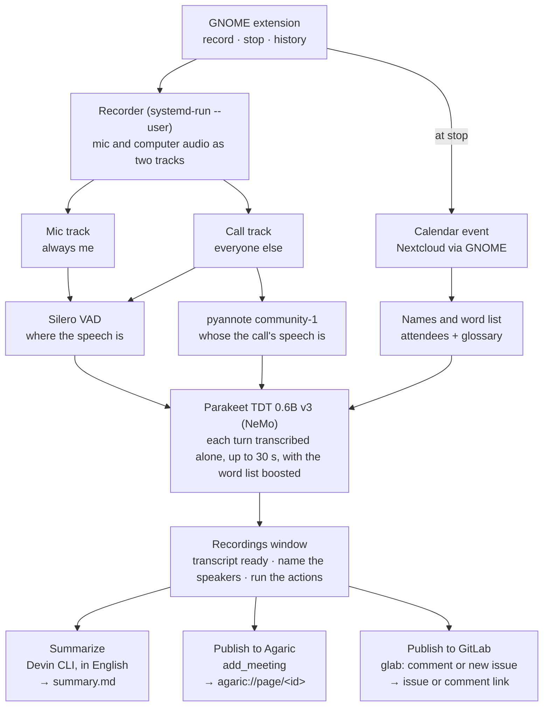
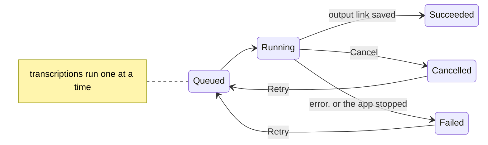

# Minutas: meeting capture for Agaric

## Goal and scope

Minutas, a local tool for GNOME on Wayland (Ubuntu 24.04's GNOME 46 and newer), records a work meeting, transcribes it with who said what, and files it in Agaric as a meeting page. Agaric already stores and shows meetings ([#5364](https://github.com/jfolcini/agaric/issues/5364)); this tool does everything before that.

- **Languages:** Spanish, Argentine accents above all, and English from non-native speakers, often in the same meeting.
- **Outputs:** a transcript on stop, then on demand a summary, an Agaric meeting page and a GitLab comment or issue, each listed with its link in the recording's history.
- **When it runs:** on the desktop, after the call; nothing heavy runs during it. Phone voice notes reach the desktop through Agaric's sync.
- **Out of scope:** live transcription, phone-call audio (Android doesn't allow capturing it), any change to Agaric, and forking an existing tool.

## Decisions

The stack is settled: Python, Parakeet v3, pyannote community-1, two recorded tracks, the calendar through GNOME, Devin for the summary and `glab` for GitLab. Only transcription runs on its own; everything else is a button in the Recordings window.

| Area | Decision | Why |
| --- | --- | --- |
| Where it lives | Outside Agaric; Agaric only stores and shows | Agaric runs no transcriber and calls no LLM ([#5364](https://github.com/jfolcini/agaric/issues/5364)) |
| Platform | GNOME 46+ on Wayland only for now; macOS and Windows later (see Later) | Ubuntu 24.04 ships GNOME 46; Ubuntu 26.04 has no Xorg session |
| Hardware | A laptop without an NVIDIA GPU | Parakeet on the CPU; Qwen3-ASR is only worth testing with a GPU |
| Install | A GitHub repository with an idempotent `install.sh`; `minutas update` moves to the latest release tag and re-runs it | Installs and updates from the repository; details under Installing and updating |
| Language | Python, managed with `uv` | pyannote community-1 is Python-only; new speech models ship in Python first; PyGObject reaches GNOME's calendar and GTK |
| Speech-to-text | Parakeet TDT 0.6B v3 through NeMo, full precision | Most accurate model that runs well on a CPU; covers Spanish and English; NeMo adds phrase boosting |
| Speakers | pyannote community-1 on the call track; the mic track is always me | Best open speaker detector; no four-speaker cap |
| Speaker names | Set per recording in the Recordings window: a calendar attendee or a custom name | A person confirms names before anything is published |
| Recording | Two tracks: mic and computer audio | "Me" versus "them" is exact without AI; speaker detection runs on the call only |
| Echo | Headphones normally; a setting records PipeWire's echo-cancelled mic instead, for days on speakers | A clean mic track without setup most days, and no duplicates when speakers are on |
| Consent | Pressing Record shows a GNOME notification: "Tell participants you're recording" | A nudge at the moment it matters; the audio may reach GitLab |
| Automation | Only transcription runs on stop; Summarize, Publish to Agaric and Publish to GitLab are buttons per recording | Nothing leaves the machine until I press a button |
| Failures | Every run ends succeeded, failed or cancelled; a failed run shows why and the fix, with a Retry button; nothing retries on its own | A blind retry can post twice or hide a real problem |
| Interface | Top-bar menu (record, stop, recent recordings, Recordings, Settings) plus a Recordings window, with the Settings in a dialog over it | The window runs outside GNOME Shell, so a bug can't freeze the desktop |
| Calendar | Nextcloud through GNOME Online Accounts and Evolution Data Server | GNOME holds the login and expands repeating meetings |
| Summary | Devin CLI (`devin -p`), always written in English, saved as `summary.md`; the model and its effort are Minutas settings, chosen from what `devin models list` offers, unset meaning Devin's default; so is the skill the summary follows, a Markdown file, unset meaning the built-in meeting-notes one | The Devin account used is cleared for meeting content; one language for every summary; Devin runs without my own Devin config, so the model and the skill are set in Minutas |
| Summary prompts | Built-in presets General, Standup, 1:1 and Stakeholder call, which can't be deleted; Custom is typed at run time and savable as a preset; saved presets can be deleted | One click for regular meetings, free text for the rest |
| Page name | The calendar event's name, else the name the summary proposes, else "Meeting"; Agaric adds the date. A name typed in the Recordings window always wins | A recurring meeting keeps one name; the summary names meetings that had no event |
| Renaming | Publish to Agaric renames the page when its automatic name changed; a typed name is never replaced | Publishing before summarizing still ends with a good name; Agaric links by id, so links survive |
| Taken name | Publish to Agaric stops and asks: Use that page or Rename | Two meetings with one name on one day are rare, and only I know whether they're the same one |
| Agaric | Publish to Agaric runs `agaric-mcp call add_meeting`, with no template; running it again adds the summary and applies a new name | The summary already lists decisions and action items, so a template would repeat them |
| GitLab | Publish to GitLab asks for a link: an issue link gets a comment, a project link a new issue with only a title and body; it posts the summary and links the uploaded transcript and audio, or the transcript alone when the server refuses the audio as too big | The link alone says where and how to post; labels and assignees are set in GitLab |
| GitLab login | [`glab`](https://docs.gitlab.com/cli/api/), logged in once per server; 1.91 or newer, which install.sh only checks for, and the Recordings window keeps Publish to GitLab off until it's there | Already handles gitlab.com and self-hosted servers; no token handling in the tool |
| Audio kept | The two tracks as Ogg Opus, 16 kHz mono at 32 kbps each (about 30 MB an hour), with the transcript and outputs, until Delete now or a limit takes them: 30 days old, or 5 GB for all the tracks together, past which the oldest go whatever their age; each limit can be turned off; no lossless copy | At that rate Opus barely changes what the speech models hear, and 16 kHz is all they take; tracks kept for weeks can still be re-transcribed with a better model, and the limits keep the disk bounded ([#18](https://github.com/jfolcini/minutas/issues/18)) |
| Audio files | Per recording, for its two tracks: Play, Save a copy, Open folder, Delete now | Manage disk and hand a file to someone without leaving the window |
| Existing tools | Inspiration only, no fork | None fits; several have a piece worth borrowing |
| Voice memory | Later, nice to have | Calendar attendees cover naming at first |

## Pipeline



Recording runs as a user service, so it survives the lock screen. Transcription runs on stop; Summarize, Publish to Agaric and Publish to GitLab are buttons in the Recordings window, and Publish to GitLab waits for a summary.

## Agaric contract

Everything goes through one MCP tool, `add_meeting`, called with Agaric's own `agaric-mcp` bridge and an agent token from Settings → Agent access. Nothing in Agaric changes. The bridge is the copy an AppImage of Agaric 0.26 or newer keeps current at `${XDG_DATA_HOME:-~/.local/share}/com.agaric.app/bin/agaric-mcp`, else the `agaric-mcp` on the PATH, where Agaric's `.deb` puts it.

```bash
agaric-mcp --token agt_… call add_meeting '{"space_id":"…","title":"Weekly sync","date":"2026-11-15","audio_path":"/…/rec.opus","transcript_path":"/…/rec.transcript.md"}'
```

| Argument | Use here |
| --- | --- |
| `space_id` | The Work space, from `list_spaces` |
| `title`, `date` | The page name (calendar event, else the summary's proposal, else "Meeting") and the recording's date; the page becomes `<title> <YYYY-MM-DD>`, tagged `#meeting`, with the `meeting_date` property |
| `template` | Not sent: meeting pages get no template. If one is added later, its `<% recording %>` block becomes the recording block |
| `audio_path` | The two tracks mixed into one Opus file at publish time; `.opus`, `.ogg`, `.mp3`, `.m4a`, `.wav`, `.webm` and `.flac` are accepted, at most 50 MB a file |
| `transcript_path` | Markdown, stored as `<name>.transcript.md` |
| `block_id` + `summary_markdown` | Publish to Agaric run again after Summarize: `block_id` is the recording block the first publish's result named, the one holding this recording's files, and the summary is written just above it; a newer summary goes there too, and the older one stays until removed in Agaric |

The transcript is one paragraph per segment; Agaric makes each timestamp seek the player.

```markdown
[00:00:04] **Ana:** Arrancamos con el release.

[00:00:11] **Me:** CI is green since this morning.
```

- The page id in `add_meeting`'s result becomes the history's output link, `agaric://page/<id>`, which opens the page in Agaric; its `recording_block_id`, which the result always carries, is the block a later, newer summary goes onto.
- Renaming is `update_block_content` on that page id with `<name> <YYYY-MM-DD>`; Agaric refuses a name another page of the space holds. A taken name on the first publish becomes Use that page or Rename; on a rename it becomes Rename only, since the page already holds the files.
- Opus at about 32 kbps is about 15 MB an hour, so about three hours fit under the cap.
- This tool's agent gets read-write access to the Work space only. Its token, `agt_` and 32 hex digits, is taken out of whatever of Agaric's was pasted; `list_spaces` then says which spaces it may use, and the only one is chosen without asking. With several, the space chosen stays while the token may use it; else Minutas asks.

## Components

One Python program does the work and draws the Recordings window; the GNOME extension only starts and stops recording, lists recent recordings and opens the window.

| Component | Job | Main library |
| --- | --- | --- |
| GNOME extension | Top-bar menu: record and stop with a timer, the last few recordings with a warning mark on any failed run, Recordings and Settings; notifications on Record ("Tell participants you're recording"), when a transcript is ready, and when a run fails | GJS, GNOME Shell 46+ |
| Recordings window | Every recording with its name, speakers, actions and their runs (status, error, Retry, Cancel, output link) and its audio files; the Settings, a dialog over it | GTK 4 and libadwaita through PyGObject |
| Player and file buttons | Play, Save a copy, Open folder and Delete now for the recording's two tracks | GTK 4 `MediaFile` and `MediaControls`, `FileDialog`, `FileLauncher` |
| Recorder | Mic and computer audio as two Opus tracks; survives the lock screen and a Shell restart; if it dies, what was captured is kept; a setting records the echo-cancelled mic instead | `systemd-run --user`, GStreamer or `pw-record`, PipeWire |
| Store | One folder per recording: the two Opus tracks, transcript, summary, the name and where it came from, the speakers' names, and a JSON log of every run with its status, error and output link | Python standard library |
| Calendar lookup | The event overlapping the recording: name, date, attendee names | PyGObject `ECal` and `EDataServer` |
| Page name | Picks the name: one typed in the Recordings window, else the calendar event's, else the summary's proposal, else "Meeting" | Python standard library |
| Turn finder | Who spoke when: Silero VAD finds the speech on both tracks; the mic's is mine, and pyannote says whose each stretch of the call's is. pyannote runs in a process of its own, which ends before Parakeet loads, from the model on disk and with its usage reporting off | Silero VAD; pyannote.audio 4 with community-1 |
| Transcriber | Runs on stop, and again on Retry or Run again: one pass per turn, same-speaker turns merged up to about 30 s, with the meeting's word list. Writes `transcript.json`: each turn's start, end and text under its speaker's key, `Me` or `Speaker 1`, `Speaker 2`… in the order they first speak. Parakeet loads from its archive unpacked once, beside it in the model cache, not unpacked to disk again on every run | NeMo, Parakeet TDT 0.6B v3, phrase boosting |
| Speaker naming | Each speaker set to a calendar attendee or a custom name in the Recordings window, kept with the recording and through Run again; voice memory later | Calendar attendees; community-1 speaker embeddings later |
| Formatter | Writes `transcript.md`, `[hh:mm:ss] **Name:** text`, from `transcript.json` and the current names, after every transcription and every naming | Python standard library |
| Summarize | A built-in preset (General, Standup, 1:1, Stakeholder call) or a saved one, or Custom typed at run time and savable as a preset; always in English. Every prompt gets the skill the Settings choose, the built-in meeting-notes one by default, then one added instruction: start with a line `Title: <a few words, no date>`, which becomes the proposed page name and is cut from `summary.md`. The transcript is other people's speech, so Devin gets it inside the prompt, in an empty temporary folder with an empty home (none of the person's MCP servers, rules or skills), and a config of its own that takes away every tool that reaches a file, a command or the web, and denies any such tool it adds later: nothing said in a meeting can make it read a file, run a command or fetch a page | Devin CLI, `devin -p --prompt-file` |
| Publish to Agaric | The page, audio and transcript; the summary once it exists; renames the page when its automatic name changed; output `agaric://page/<id>` | `agaric-mcp call add_meeting`, `update_block_content` |
| Publish to GitLab | Asks for a link; uploads transcript and audio, posts the summary with their links as a comment or a new issue titled `<name> <YYYY-MM-DD>`; output the comment or issue link; enabled once a summary exists | `glab api` (uploads, issues, notes) |
| Scorer | Word error rate on the test set for every change | `jiwer` |

### Between the extension and the program

The extension holds no state of its own: it runs the commands below and watches one file. `DATA` is `${XDG_DATA_HOME:-~/.local/share}/minutas`, and each recording is a folder `DATA/recordings/<id>`, named by its local start time (`2026-11-18T13-05-42`).

| Command | Does |
| --- | --- |
| `minutas record start` | Starts the recorder unit, waits until both tracks receive audio, and prints `{"id": …, "started_at": …}`; exits 1 with the reason on stderr when already recording or no audio arrives |
| `minutas record stop` | Stops the recorder; exits 1 when nothing is recording |
| `minutas repair` | Marks a recording whose recorder is gone stopped and incomplete, and starts the transcription worker, which fails a run left running as interrupted and takes the queued ones; leaves a running recorder and a running worker alone; exits 1 when the worker won't start. The extension runs it each time it is enabled: at login, and after unlocking |
| `minutas history [--recording <id>]` | Opens the Recordings window, on that recording when one is given; with the window already open, brings it forward and shows that recording |
| `minutas settings` | Opens the Recordings window with the Settings over it |

The program rewrites `DATA/status.json` atomically after every change, and the extension reads it with a file monitor:

```json
{
  "version": 1,
  "recording": {"id": "2026-11-18T13-05-42", "started_at": "2026-11-18T13:05:42+01:00"},
  "recent": [
    {"id": "2026-11-18T12-00-03", "name": "Meeting", "started_at": "2026-11-18T12:00:03+01:00",
     "duration_seconds": 1834, "incomplete": false, "transcribe": "succeeded", "failed": []}
  ]
}
```

- `recording` is the active recording, or `null`; `recent` holds the last five others, newest first.
- `incomplete` means the recorder died before Stop; what it captured is kept.
- `transcribe` is the latest Transcribe run's status, or `null`; `failed` lists the actions whose latest run failed: `transcribe`, `summarize`, `publish_agaric`, `publish_gitlab`.

## Installing and updating

Minutas lives in a GitHub repository. `install.sh` installs and updates it: it can run any number of times, and each step only acts when something is missing or changed.

| Step | What it puts in place | Skipped when |
| --- | --- | --- |
| System packages | `python3-gi`, `gir1.2-gtk-4.0`, `gir1.2-adw-1`, GTK's GStreamer media backend for Play, `gir1.2-ecal-2.0`, `gir1.2-edataserver-1.2`, GStreamer's base and good plugins and `gst-launch-1.0` (Opus, Ogg, and capture through PipeWire's PulseAudio server), `gio`, `secret-tool` and `curl`, through `apt` | All are installed |
| uv | `uv` and `uvx` at the version pinned in the repository, in `~/.local/bin`, from uv's release archive on GitHub, unpacked only once it matches the sha256 pinned beside the version | That version is there |
| Speech environment | Parakeet through NeMo, pyannote.audio, Silero VAD and CPU-only PyTorch, synced from `uv.lock` into `~/.local/share/minutas/speech` with a uv-managed Python | `uv.lock` didn't change |
| App | The program in `~/.local/share/minutas/app`, a virtual environment on Ubuntu's Python with its system packages, holding the package and its dependencies from `uv.lock`; the `minutas` command in `~/.local/bin`; a desktop file for the Recordings window | Files are identical |
| GNOME extension | `~/.local/share/gnome-shell/extensions/minutas@jfolcini.github.io/`, enabled in GNOME Shell's `enabled-extensions` setting: `gnome-extensions enable` asks the running Shell, which refuses an extension it found no files for at login | Files are identical and it's enabled |
| Hugging Face token | Asked once, after you accept pyannote's conditions on Hugging Face, which gate its speaker model, as the script says when it asks; kept in the GNOME keyring | The keyring has it |
| Models | Parakeet v3 and pyannote community-1 at the revisions pinned in the repository, in `~/.cache/minutas/models` | Those revisions are there |
| agaric-mcp | Nothing; says to install Agaric 0.26 or newer and start it once, which puts in place the bridge Publish to Agaric's `call` needs | Agaric's own bridge (see Agaric contract), else the `agaric-mcp` on the PATH, has `call` |
| glab | Nothing; names an older one it found and points to GitLab's own `.deb` of 1.91 or newer, which replaces Ubuntu's in place (the snap can't read `~/.local/share`, where the recordings are) | `glab` 1.91 or newer is on the PATH |
| Devin CLI | Nothing; prints how to install it | It's on the PATH |

- **Output:** in a terminal, it opens with what it puts in place and what it may ask for, and why; every step prints `ok` when nothing needed doing, or what it installed or updated, and a second run in a row prints `ok` for all of them; it ends with what is left to do, if anything: log out and back in, and the optional tools still missing.
- **No needless downloads:** the tool versions, `uv.lock` and the model revisions are pinned in the repository, so a release that doesn't change them downloads nothing; uv's and Hugging Face's caches keep files between runs, and an interrupted model download starts that file again without leaving the partial one behind.
- **Failures:** a failed step stops the script with what went wrong and what to do; running it again carries on from there.
- **sudo:** asked only when `apt` actually has something to install, saying that is what it is for. Without a terminal to ask in, as under Update Minutas, the step stops with the `apt` command to run in one; so does the Hugging Face token step.
- **Updating:** `minutas update` fetches the repository's tags, checks out the latest release tag and re-runs `install.sh`; on the latest tag it says so, and `install.sh` finishes an update that stopped partway or prints `ok` for every step. It updates the clone `install.sh` last ran from, which the App step links at `~/.local/share/minutas/app/repository`; release tags are `v<version>`, and the highest version is the latest. The Recordings window's Update Minutas runs it as a command, with a banner while it runs, its output going to `DATA/update.log` so that closing the window doesn't cut it off; then it says what came of it: already on the latest release; updated, and the window must be closed and opened again to run the new version, and when `install.sh` says so, the session logged out and back in; or failed, with the last line it printed and Details for all of it.
- **Two Pythons:** the window and the calendar use Ubuntu's Python, for its PyGObject bindings; the speech stack uses its own uv-managed Python, so it works on Ubuntu 24.04 and later whatever Python each release ships.
- **Log out once:** GNOME on Wayland loads a new or changed extension only at the next login, so the script says when that's needed, at the extension step and again at the end.
- **Tested:** CI runs `install.sh` twice on Ubuntu 24.04, without the models; the second run must print `ok` for every step. `MINUTAS_SKIP_MODELS=1` leaves out the Hugging Face token and model steps there.

## Later: more tools and platforms

The first version supports Devin, GitLab and GNOME on Ubuntu only; GitHub, Claude, Codex, macOS and Windows may follow, so the code keeps each of those behind its own module without building a plugin system now.

| Addition | How it fits | Known catch |
| --- | --- | --- |
| Claude, Codex | Another summarizer next to Devin: Claude Code's `claude -p` and Codex's `codex exec` take a prompt and print Markdown, as `devin -p` does | The `Title:` line instruction must work with each; each is another choice in the Settings' Summarizer, with its own models |
| GitHub | Another publisher next to GitLab, through `gh` 2.99 or newer, the counterpart of `glab`: `gh issue comment` on an issue link, `gh issue create` on a repository link, both logged in with `gh auth login` | `gh --attach` [uploads only image and media files](https://docs.github.com/en/github-cli/github-cli/attaching-files-with-github-cli) and needs push access: the transcript would go to a secret gist (`gh gist create`); whether Opus audio in a WebM file counts as media needs a test, else a release asset |
| macOS | A menu-bar item instead of the GNOME extension; system audio through ScreenCaptureKit; the calendar straight from Nextcloud over CalDAV | No GNOME Online Accounts or Evolution Data Server; the Recordings window would need a native toolkit to feel at home; Parakeet may run better through Apple's MLX than NeMo |
| Windows | A tray icon; system audio through WASAPI loopback; the calendar over CalDAV; a PowerShell install script | NeMo and pyannote on Windows need checking; no `systemd-run`, so recording runs under the app itself |

- **Kept separate from the start:** the summarizer, the publisher, the recorder, the calendar lookup and the top-bar integration each sit in their own module, with the Recordings window and the run log talking only to those modules.
- **Portable choices that cost nothing now:** secrets go through Python's `keyring` package, which uses the GNOME keyring here and the system stores on macOS and Windows; the speech environment, store, formatter and run log are plain Python.

## Recordings window

Every recording is a row, newest first; expanding it shows its speakers, its audio files and its four actions, each with its last result: an output link, or why it failed and a Retry button.

- **Name:** the row's name says where it came from (calendar, summary or default) and has Edit; a typed name is kept for good, and the next Publish to Agaric applies it.
- **Speakers:** the call's speakers are listed under Transcribe once it has run, numbered in the order they first speak; each one is set to a calendar attendee or a custom name, and the transcript is written again with it; a transcript already published keeps the names it went with.
- **Actions:** Transcribe (runs on stop; Run again re-transcribes, for example after the word list changes), Summarize, Publish to Agaric and Publish to GitLab. Every run is kept with its time, status and output link; Publish to Agaric run again adds what the page lacks, such as the summary or a newer one, and applies a changed name.
- **Failed runs:** show the reason and the fix, with Retry and Details; see *When an action fails* below.
- **Summarize:** the menu lists built-in presets, saved presets, then Custom; Custom opens a text box with Save as preset. Saved presets can be deleted from the menu's Delete a preset, built-in ones can't. Without the Devin CLI on the PATH, Summarize is disabled and says how to install it.
- **Publish to GitLab:** enabled once a summary exists; its dialog asks for the link, starting from the last run's, and says before posting whether it will get a comment or a new issue. Without `glab` 1.91 or newer on the PATH, it is disabled and recommends GitLab's own `.deb`: the snap can't read the recordings.
- **Audio files:** the mic and call tracks, each with Play and Save a copy; Delete now removes both, Open folder opens the recording's folder, and the row says when the age limit will delete them.
- **Deleting:** asks first; the history entry and its outputs stay. Without the tracks, Run again is disabled, and publishing leaves the audio out and says so.
- **Audio limits:** delete tracks as Delete now does, but only once the latest transcription has succeeded and never the recording in progress; they run when a recording stops, when the window opens and when they are saved, with no timer of their own. A change to them waits for Save, unlike every other setting, and Save first warns how many recordings' audio, and how much of it, goes at once, with Accept and Cancel: a scroll over a limit would otherwise delete audio unasked.
- **Links:** open in the default app: `summary.md` in the text editor, `agaric://` links in Agaric, GitLab links in the browser.
- **Settings:** a dialog over the window, opened from its main menu or the top-bar menu. Transcription: the vocabulary, the glossary of the word list, with Open, which opens it in the text editor, one word or phrase a line. Summary: the summarizer (only the Devin CLI for now), then the model and its effort, from what `devin models list --format json` offers, and the skill file, Markdown, with Open, which opens it or the built-in one, and Use built-in to go back to the one Minutas ships; Agaric; the audio limits with how much audio is kept against them. Later: the echo-cancelled mic switch, whether `glab` is logged in.
- **Agaric:** the agent token, pasted as the config Agaric shows or alone, kept in the GNOME keyring through Python's keyring package and never shown back; whether a token is stored, and without one how to get Agaric's config; the space it publishes to, shown even when it is the only one; and the fix when Agaric isn't running or refuses the token. Agaric is asked through `minutas settings agaric`, run as a command, so the window never waits on it.
- **Main menu:** Settings; Update Minutas (see Installing and updating); About Minutas, with the version, the license, the website and where to report an issue.
- **Top-bar menu:** record and stop, the last few recordings, Recordings and Settings.

## When an action fails

A failed run never disappears: it shows what went wrong and how to fix it, and waits for Retry.



A run still marked Running when the app starts again, after a logout or a crash, becomes Failed with the reason "interrupted".

| Action | What can fail | What the history does |
| --- | --- | --- |
| Recording | The recorder dies, an audio device disappears, the disk fills | Keeps what was captured, marks the recording incomplete with the time it stopped, and still offers Transcribe |
| Transcribe | Out of memory, a model fails to load, a crash | Failed with the log; Retry runs again from the tracks |
| Summarize | Devin not logged in, a non-zero exit, empty output, no answer at all | Failed with Devin's output in Details; a Devin that stalls is stopped after a generous timeout; the run keeps the prompt it used, Custom included, so Retry sends the same one |
| Publish to Agaric | Agaric not running, the agent token revoked, a file over 50 MB, the name already taken by another page | Failed with Agaric's message; `add_meeting` is one transaction, so a failed call leaves nothing behind. A taken name stops the run and asks: Use that page (adds the files to it) or Rename; a rename to a taken name asks for another name |
| Publish to GitLab | `glab` not logged in for that server, no access to the link, an upload over the server's limit, network down | Failed at the step that broke, with the fix (for example `glab auth login --hostname <host>`); a finished audio upload is kept in the run, so Retry doesn't upload it again. Audio over the limit is the exception: the summary goes out with the transcript alone and the run's note says so; only an admin can read the limit, so the smallest audio each server refused is remembered and a later one as big isn't sent |

- **Where failures show:** a red status on the run, a warning mark on the recording in the top-bar menu, and a GNOME notification.
- **Details:** the full output of the tool that failed, ready to copy.
- **Cancel:** stops a queued or running run; a cancelled run can be retried like a failed one.
- **Dependencies:** Publish to GitLab stays disabled until a summary succeeds, and says why.

## Transcription quality plan

Every model or setting change is judged against a test set made from my own meetings, because no published benchmark covers Argentine Spanish.

1. **Test set:** about 25 minutes of Argentine Spanish, accented English and Spanglish, corrected by hand and kept local.
2. **Score:** word error rate with `jiwer`. For an extra accent check, add [OpenSLR 61](https://www.openslr.org/61/) (Argentine Spanish, read aloud) and the [Common Voice Spanish](https://datacollective.mozillafoundation.org/datasets/cmn4z1n52000knv07h01532dd) clips tagged rioplatense, local use only.
3. **Word list:** attendee names plus a glossary, the Settings' vocabulary (clients, products, English jargon used in Spanish such as "deploy" or "PR"), passed per meeting through [NeMo phrase boosting](https://docs.nvidia.com/nemo/speech/latest/asr/asr_customization/word_boosting.html).
4. **Precision:** full precision; the int8 build did about 4 points worse on Spanish in [one small test](https://github.com/groxaxo/parakeet-tdt-0.6b-v3-fastapi-openai).
5. **Language switching:** Parakeet detects the language per input, so each turn is transcribed alone; merging a speaker's turns up to about 30 s keeps short words ("dale", "OK") from flipping the detection.
6. **Fine-tuning:** only if the test set shows a gap on the Argentine accent; it needs a GPU and the Rioplatense clips.

## Model landscape (November 2026)

Parakeet v3 is about one point of error behind the two newer leaders, but it is the only one of them that runs well on a CPU, and it beats Whisper clearly on accents.

| Model | English error, leaderboard | 14-accent call benchmark | Size | Languages | Runs on |
| --- | --- | --- | --- | --- | --- |
| [Nemotron 3.5 Transcribe](https://huggingface.co/nvidia/NVIDIA-Nemotron-3.5-Transcribe-30B-A4B-FP8) | 6.13% | not tested | 34B (4.3B active) | 40 | Data-centre GPU |
| [Qwen3-ASR 1.7B](https://github.com/QwenLM/Qwen3-ASR) | 6.15% | 8.3% | 1.7B | 52 | NVIDIA GPU |
| [Parakeet TDT 0.6B v3](https://huggingface.co/nvidia/parakeet-tdt-0.6b-v3) | 7.04% | 9.2% | 0.6B | 25 European | CPU |
| Whisper large-v3 | 8.24% | 15.0% | 1.55B | 99 | GPU; slow on CPU |

Leaderboard figures are a [third-party snapshot of 9 November 2026](https://thinkscribe.ai/en/blog/open-speech-recognition-models-2026); the accent figures come from a [benchmark of VoIP calls in 14 English accents](https://arxiv.org/html/2604.27543), which has no Spanish-accented speakers.

- **Spanish:** Parakeet v3 scores 3.45% on FLEURS and 4.39% on MLS, both read speech; on Spanish YouTube clips it scored 15.3% against Whisper large-v3's 20.7%.
- **Challenger:** Qwen3-ASR 1.7B, if an NVIDIA GPU becomes available; the turn-by-turn design lets the model be swapped.

## Prior art

No existing tool does the whole job on Linux; each row is something to borrow, judged from its README, not run.

| Tool | Borrow | Why not as the base |
| --- | --- | --- |
| [heed](https://github.com/isjunrod/heed) | Mic and system audio on separate channels; voice memory across meetings | Linux uses pyannote 3.1 and has no export yet; Bun, Python and Swift stack |
| [HushNote](https://github.com/peteonrails/hushnote) | One folder per meeting; interactive speaker labelling; a post-summary hook | Unclear whether it keeps tracks apart; Whisper only |
| [meeting-recorder](https://github.com/chamilto0516/meeting-recorder) | A WAV per source; `start`, `stop`, `status`, `retry`, `reprocess` commands | Transcribes the mix; no speaker detection |
| [ownscribe](https://github.com/paberr/ownscribe) | WhisperX with community-1; Markdown output | System-audio capture is macOS-only |
| [Murmur](https://github.com/roman-16/murmur) | Top-bar experience; numbered voices; audio and transcript side by side | Cloud transcription only; GNOME 47 to 51, not 46 |
| [Scriberr](https://github.com/rishikanthc/Scriberr) | Parakeet and pyannote behind a REST API | A Docker web service; development paused |
| [Meetily](https://github.com/Zackriya-Solutions/meetily) | Whisper or Parakeet on device | Speaker identification and export are in the paid tier |

## Milestones

The scorer comes first, so every later step is measured; the tool is usable end to end after M3, when a recording reaches Agaric from the Recordings window.

- [ ] **M0:** GitHub repository, `uv` project, `install.sh` with the system packages, uv, speech environment, token and model steps, the test set and the `jiwer` scorer
- [ ] **M1:** recorder with two Opus tracks under `systemd-run --user`, keeping what was captured if it dies, with the echo-cancelled mic setting; the per-recording folder
- [ ] **M2:** transcription on stop: Silero VAD on both tracks, Parakeet per turn, the formatter ("Me" and "Speaker n"); measure an hour of audio on the laptop
- [ ] **M3:** Recordings window: recordings, the run log (queued, running, succeeded, failed, cancelled, interrupted) with Retry, Cancel and Details, the audio buttons (Play, Save a copy, Open folder, Delete), Transcribe's Run again, the name with Edit ("Meeting" by default), and Publish to Agaric with its output link and the Use that page or Rename prompt
- [ ] **M4:** calendar lookup through GNOME Online Accounts: the event's name as the page name, the date, attendees and the word list
- [ ] **M5:** community-1 on the call track; speakers named in the Recordings window from the attendees or a custom name
- [ ] **M6:** Summarize: built-in presets (General, Standup, 1:1, Stakeholder call), saved presets, Custom with Save as preset, deleting saved presets, Devin CLI, `summary.md`, the proposed page name from its `Title:` line; Publish to Agaric adds the summary and renames the page when its automatic name changed
- [ ] **M7:** Publish to GitLab through `glab api`: comment or new issue (title and body only), transcript and audio uploads, Retry carrying on from the failed step, the output link
- [ ] **M8:** GNOME extension: record and stop, the consent reminder on Record, recent recordings with a mark on failed runs, Open history, notifications for a ready transcript or a failed run; `install.sh` complete, with the glab and extension steps, and `minutas update`
- [ ] **Later:** voice memory; fine-tuning on Rioplatense speech if the test set shows a gap; Claude and Codex summarizers; publishing to GitHub; macOS and Windows

## Open questions

Everything is decided.

- [x] How long does an hour of audio take on the laptop at full precision with phrase boosting? Measured in M2 ([#5](https://github.com/jfolcini/minutas/issues/5)): Parakeet takes about a tenth of the recording's length, so full precision stays and int8 isn't needed. With speaker detection, measured in M5 ([#8](https://github.com/jfolcini/minutas/issues/8)), a transcription takes about a quarter of it, most of that pyannote on the call track. Moving pyannote's window three seconds at a time instead of one ([#46](https://github.com/jfolcini/minutas/issues/46)) brings it to about a sixth, most of that Parakeet; a two-hour meeting stays well inside the transcription's memory limit.

## Sources

- [Agaric #5364: voice notes and meetings](https://github.com/jfolcini/agaric/issues/5364)
- [Open speech recognition models, leaderboard snapshot of 9 Nov 2026](https://thinkscribe.ai/en/blog/open-speech-recognition-models-2026)
- [Multi-accent call-centre English ASR benchmark](https://arxiv.org/html/2604.27543)
- [Parakeet TDT 0.6B v3 model card](https://huggingface.co/nvidia/parakeet-tdt-0.6b-v3)
- [Parakeet v3 Spanish test (groxaxo)](https://github.com/groxaxo/parakeet-tdt-0.6b-v3-fastapi-openai)
- [Qwen3-ASR](https://github.com/QwenLM/Qwen3-ASR)
- [Nemotron 3.5 Transcribe model card](https://huggingface.co/nvidia/NVIDIA-Nemotron-3.5-Transcribe-30B-A4B-FP8)
- [NeMo word boosting](https://docs.nvidia.com/nemo/speech/latest/asr/asr_customization/word_boosting.html)
- [pyannote speaker-diarization-community-1](https://huggingface.co/pyannote/speaker-diarization-community-1)
- [OpenSLR 61: Argentinian Spanish](https://www.openslr.org/61/)
- [Common Voice Spanish 25.0](https://datacollective.mozillafoundation.org/datasets/cmn4z1n52000knv07h01532dd)
- [Devin CLI commands and flags](https://docs.devin.ai/cli/reference/commands)
- [Devin CLI MCP configuration](https://cli.devin.ai/docs/extensibility/mcp/configuration)
- [glab api](https://docs.gitlab.com/cli/api/)
- [glab issue note](https://docs.gitlab.com/cli/issue/note/)
- [PipeWire echo-cancel module](https://docs.pipewire.org/page_module_echo_cancel.html)
- [Ubuntu 26.04 LTS release notes](https://documentation.ubuntu.com/release-notes/26.04/summary-for-lts-users/)
